# Banco de dados

> Gerado sozinho por `pnpm banco:documentar` a partir das migrações (`nucleo/migracoes`). Não edite à mão:
> mude a migração e gere de novo. O porquê das escolhas está em [decisoes.md](decisoes.md).

## Diagrama

```mermaid
erDiagram
  acontecimentos_de_tarefa {
    uuid id PK
    uuid empresa_id FK
    uuid tarefa_id
    uuid autor_pessoa_id
    uuid autor_agente_id
    text tipo
    jsonb detalhes
    timestamp_with_time_zone criado_em
  }
  agentes {
    uuid id PK
    uuid empresa_id FK
    text nome
    text descricao
    text tipo
    text onde_roda
    uuid responsavel_id
    text situacao
    integer minutos_sem_sinal
    timestamp_with_time_zone ultimo_sinal_em
    timestamp_with_time_zone criado_em
    timestamp_with_time_zone atualizado_em
    timestamp_with_time_zone desligado_em
  }
  ajustes_de_permissao {
    uuid id PK
    uuid empresa_id FK
    uuid vinculo_id FK
    text modulo
    text acao
    text alcance
    uuid feito_por FK
    timestamp_with_time_zone feito_em
  }
  assinaturas_de_push {
    uuid id PK
    uuid empresa_id FK
    uuid pessoa_id
    uuid aparelho_id FK
    text endpoint
    text p256dh
    text auth
    timestamp_with_time_zone criada_em
    timestamp_with_time_zone ultimo_envio_em
  }
  avisos {
    uuid id PK
    uuid empresa_id FK
    uuid pessoa_id
    text tipo
    text texto
    text link
    timestamp_with_time_zone criado_em
    timestamp_with_time_zone lido_em
    uuid tarefa_id
    boolean push_pendente
  }
  chaves_de_agente {
    uuid id PK
    uuid empresa_id FK
    uuid agente_id
    text nome
    text prefixo
    text resumo
    uuid criada_por
    timestamp_with_time_zone criada_em
    timestamp_with_time_zone valida_ate
    timestamp_with_time_zone ultimo_uso_em
    timestamp_with_time_zone revogada_em
    uuid revogada_por
  }
  comentarios_de_tarefa {
    uuid id PK
    uuid empresa_id FK
    uuid tarefa_id
    uuid autor_pessoa_id
    uuid autor_agente_id
    text texto
    timestamp_with_time_zone criado_em
    text tipo
    timestamp_with_time_zone editado_em
    timestamp_with_time_zone apagado_em
  }
  contadores_de_agente {
    uuid empresa_id FK
    uuid agente_id
    uuid chave_id
    text janela
    timestamp_with_time_zone inicio
    integer valor
  }
  empresas {
    uuid id PK
    text nome
    timestamp_with_time_zone criada_em
    timestamp_with_time_zone atualizada_em
    text situacao
    boolean exigir_dois_fatores
    boolean exigir_passkey
    text tipo
    text documento
    text nome_legal
    text fuso_horario
    text idioma
    text telefone
  }
  espacos {
    uuid id PK
    uuid empresa_id FK
    text nome
    text descricao
    text cor
    text situacao
    timestamp_with_time_zone criado_em
    timestamp_with_time_zone atualizado_em
  }
  estados_de_prioridade {
    uuid empresa_id PK
    uuid pessoa_id PK
    text chave PK
    timestamp_with_time_zone adiado_ate
    timestamp_with_time_zone resolvido_em
    timestamp_with_time_zone mudou_em
  }
  etiquetas {
    uuid id PK
    uuid empresa_id FK
    text nome
    text cor
    timestamp_with_time_zone criada_em
  }
  etiquetas_de_tarefa {
    uuid empresa_id FK
    uuid tarefa_id PK
    uuid etiqueta_id PK
  }
  itens_de_checklist {
    uuid id PK
    uuid empresa_id FK
    uuid tarefa_id
    text texto
    integer ordem
    boolean marcado
    uuid marcado_por_pessoa_id
    uuid marcado_por_agente_id
    timestamp_with_time_zone marcado_em
    timestamp_with_time_zone criado_em
  }
  listas {
    uuid id PK
    uuid empresa_id FK
    uuid projeto_id
    text nome
    integer ordem
    timestamp_with_time_zone criada_em
    timestamp_with_time_zone atualizada_em
  }
  membros_de_projeto {
    uuid id PK
    uuid empresa_id FK
    uuid projeto_id
    uuid pessoa_id
    uuid agente_id
    timestamp_with_time_zone criado_em
  }
  mencoes_de_comentario {
    uuid id PK
    uuid empresa_id FK
    uuid comentario_id FK
    uuid tarefa_id
    uuid pessoa_id
    uuid agente_id
  }
  papeis_plataforma {
    uuid pessoa_id PK
    text papel
    timestamp_with_time_zone concedido_em
  }
  pessoas {
    uuid id PK
    text nome
    text email
    text foto
    text idioma
    text fuso_horario
    text situacao
    timestamp_with_time_zone criada_em
    timestamp_with_time_zone atualizada_em
    boolean email_verificado
    boolean dois_fatores_ativo
  }
  preferencias_de_notificacao {
    uuid empresa_id PK
    uuid pessoa_id PK
    jsonb preferencias
    timestamp_with_time_zone atualizadas_em
  }
  projetos {
    uuid id PK
    uuid empresa_id FK
    uuid espaco_id
    text nome
    text descricao
    text cor
    text situacao
    uuid diretor_id
    uuid gerente_pessoa_id
    uuid gerente_agente_id
    boolean gerente_recebe_sem_responsavel
    date inicio
    date fim
    timestamp_with_time_zone criado_em
    timestamp_with_time_zone atualizado_em
  }
  seguidores_de_tarefa {
    uuid empresa_id FK
    uuid tarefa_id PK
    uuid pessoa_id PK
    timestamp_with_time_zone desde
  }
  status_de_projeto {
    uuid id PK
    uuid empresa_id FK
    uuid projeto_id
    text nome
    text cor
    text tipo
    integer ordem
  }
  tarefas {
    uuid id PK
    uuid empresa_id FK
    text titulo
    text descricao
    text status
    uuid responsavel_pessoa_id
    uuid responsavel_agente_id
    uuid criada_por_pessoa_id
    uuid criada_por_agente_id
    uuid travada_por_pessoa_id
    uuid travada_por_agente_id
    timestamp_with_time_zone travada_em
    text resultado
    uuid resultado_por_pessoa_id
    uuid resultado_por_agente_id
    timestamp_with_time_zone criada_em
    timestamp_with_time_zone atualizada_em
    timestamp_with_time_zone encerrada_em
    uuid projeto_id
    uuid lista_id
    uuid status_do_projeto_id
    uuid tarefa_mae_id
    text prioridade
    date prazo_dia
    time_without_time_zone prazo_hora
    text prazo_fuso
    timestamp_with_time_zone prazo_em
    date inicio
    jsonb recorrencia
    integer ocorrencia
    uuid recorrente_de_id
    timestamp_with_time_zone avisou_prazo_hoje_em
    timestamp_with_time_zone avisou_prazo_vencido_em
  }
  vinculos {
    uuid id PK
    uuid empresa_id FK
    uuid pessoa_id FK
    text perfil
    text area
    text situacao
    timestamp_with_time_zone convidado_em
    timestamp_with_time_zone entrou_em
    timestamp_with_time_zone desligado_em
  }
  visoes_salvas {
    uuid id PK
    uuid empresa_id FK
    uuid pessoa_id
    text nome
    text tipo
    jsonb filtro
    text agrupar_por
    timestamp_with_time_zone criada_em
  }
  auditoria_correntes {
    uuid corrente PK
    bigint ultima_sequencia
    text ultimo_hash
  }
  auditoria_eventos {
    uuid id PK
    uuid empresa_id FK
    uuid corrente
    bigint sequencia
    jsonb ator
    text acao
    jsonb alvo
    jsonb origem
    timestamp_with_time_zone ocorrido_em
    text rastreio
    jsonb detalhes
    text hash_anterior
    text hash
    timestamp_with_time_zone copiado_em
  }
  acesso_aparelhos {
    uuid id PK
    uuid pessoa_id FK
    text etiqueta
    text nome
    timestamp_with_time_zone primeiro_acesso
    timestamp_with_time_zone ultimo_acesso
  }
  acesso_avisos {
    uuid id PK
    uuid pessoa_id FK
    text tipo
    uuid aparelho_id FK
    text aparelho_nome
    text ip
    timestamp_with_time_zone criado_em
    timestamp_with_time_zone respondido_em
    text resposta
  }
  acesso_convites {
    uuid id PK
    uuid empresa_id FK
    uuid vinculo_id FK
    uuid pessoa_id FK
    text codigo
    uuid convidado_por FK
    timestamp_with_time_zone criado_em
    timestamp_with_time_zone expira_em
    timestamp_with_time_zone usado_em
    timestamp_with_time_zone cancelado_em
  }
  acesso_convites_de_empresa {
    uuid id PK
    text nome
    text email
    text codigo
    uuid convidado_por FK
    timestamp_with_time_zone criado_em
    timestamp_with_time_zone expira_em
    timestamp_with_time_zone usado_em
    timestamp_with_time_zone cancelado_em
    uuid empresa_id FK
  }
  acesso_credenciais {
    uuid id PK
    uuid pessoa_id FK
    text provedor
    text conta_no_provedor
    text senha
    text token_acesso
    text token_renovacao
    text token_id
    timestamp_with_time_zone token_acesso_expira_em
    timestamp_with_time_zone token_renovacao_expira_em
    text escopo
    timestamp_with_time_zone criada_em
    timestamp_with_time_zone atualizada_em
  }
  acesso_dois_fatores {
    uuid id PK
    uuid pessoa_id FK
    text segredo
    text codigos_recuperacao
    boolean verificado
    integer falhas
    timestamp_with_time_zone travado_ate
  }
  acesso_limites {
    uuid id PK
    text chave
    integer pedidos
    bigint ultimo_pedido
  }
  acesso_passkeys {
    uuid id PK
    uuid pessoa_id FK
    text nome
    text chave_publica
    text credencial_id
    integer contador
    text tipo_aparelho
    boolean copia_na_nuvem
    text transportes
    text aaguid
    timestamp_with_time_zone criada_em
  }
  acesso_regras_da_plataforma {
    boolean unica PK
    boolean exigir_passkey_administradores
  }
  acesso_sessoes {
    uuid id PK
    uuid pessoa_id FK
    uuid empresa_id FK
    text token
    text ip
    text navegador
    timestamp_with_time_zone expira_em
    timestamp_with_time_zone criada_em
    timestamp_with_time_zone atualizada_em
    timestamp_with_time_zone dois_fatores_em
    text dois_fatores_metodo
    uuid aparelho_id FK
    timestamp_with_time_zone ultimo_uso_em
  }
  acesso_travas {
    text email PK
    integer falhas
    timestamp_with_time_zone ultima_falha
    timestamp_with_time_zone travada_ate
  }
  acesso_verificacoes {
    uuid id PK
    text identificador
    text valor
    timestamp_with_time_zone expira_em
    timestamp_with_time_zone criada_em
    timestamp_with_time_zone atualizada_em
  }
  empresas ||--o{ acontecimentos_de_tarefa : "empresa_id"
  empresas ||--o{ agentes : "empresa_id"
  empresas ||--o{ ajustes_de_permissao : "empresa_id"
  vinculos ||--o{ ajustes_de_permissao : "vinculo_id"
  pessoas ||--o{ ajustes_de_permissao : "feito_por"
  empresas ||--o{ assinaturas_de_push : "empresa_id"
  acesso_aparelhos ||--o{ assinaturas_de_push : "aparelho_id"
  empresas ||--o{ avisos : "empresa_id"
  empresas ||--o{ chaves_de_agente : "empresa_id"
  empresas ||--o{ comentarios_de_tarefa : "empresa_id"
  empresas ||--o{ contadores_de_agente : "empresa_id"
  empresas ||--o{ espacos : "empresa_id"
  empresas ||--o{ estados_de_prioridade : "empresa_id"
  empresas ||--o{ etiquetas : "empresa_id"
  empresas ||--o{ etiquetas_de_tarefa : "empresa_id"
  empresas ||--o{ itens_de_checklist : "empresa_id"
  empresas ||--o{ listas : "empresa_id"
  empresas ||--o{ membros_de_projeto : "empresa_id"
  empresas ||--o{ mencoes_de_comentario : "empresa_id"
  comentarios_de_tarefa ||--o{ mencoes_de_comentario : "comentario_id"
  pessoas ||--o{ papeis_plataforma : "pessoa_id"
  empresas ||--o{ preferencias_de_notificacao : "empresa_id"
  empresas ||--o{ projetos : "empresa_id"
  empresas ||--o{ seguidores_de_tarefa : "empresa_id"
  empresas ||--o{ status_de_projeto : "empresa_id"
  empresas ||--o{ tarefas : "empresa_id"
  empresas ||--o{ vinculos : "empresa_id"
  pessoas ||--o{ vinculos : "pessoa_id"
  empresas ||--o{ visoes_salvas : "empresa_id"
  empresas ||--o{ auditoria_eventos : "empresa_id"
  pessoas ||--o{ acesso_aparelhos : "pessoa_id"
  pessoas ||--o{ acesso_avisos : "pessoa_id"
  acesso_aparelhos ||--o{ acesso_avisos : "aparelho_id"
  empresas ||--o{ acesso_convites : "empresa_id"
  vinculos ||--o{ acesso_convites : "vinculo_id"
  pessoas ||--o{ acesso_convites : "pessoa_id"
  pessoas ||--o{ acesso_convites : "convidado_por"
  pessoas ||--o{ acesso_convites_de_empresa : "convidado_por"
  empresas ||--o{ acesso_convites_de_empresa : "empresa_id"
  pessoas ||--o{ acesso_credenciais : "pessoa_id"
  pessoas ||--o{ acesso_dois_fatores : "pessoa_id"
  pessoas ||--o{ acesso_passkeys : "pessoa_id"
  pessoas ||--o{ acesso_sessoes : "pessoa_id"
  empresas ||--o{ acesso_sessoes : "empresa_id"
  acesso_aparelhos ||--o{ acesso_sessoes : "aparelho_id"
```

## Marcas

| Marca | Significa |
| --- | --- |
| `empresa` | Dado da empresa |
| `pessoal` | Dado pessoal (LGPD) |
| `sensivel` | Dado pessoal sensível (LGPD, art. 5º, II) |
| `sistema` | Controle técnico do sistema |

## Dicionário de dados

### acontecimentos_de_tarefa

O que aconteceu em cada tarefa, para a linha do tempo. Só se acrescenta; detalhes com ids e valores fixos, sem texto.

Isolamento por empresa (Row Level Security): ligado e forçado.

| Coluna | Tipo | Obrigatória | Padrão | Marca | Descrição |
| --- | --- | --- | --- | --- | --- |
| id | uuid | sim | `uuidv7()` | sistema | Identificador do acontecimento (UUID v7). Chave primária. |
| empresa_id | uuid | sim |  | sistema | Empresa (a mesma da tarefa). Aponta para empresas.id. |
| tarefa_id | uuid | sim |  | sistema | Tarefa. |
| autor_pessoa_id | uuid | não |  | sistema | Pessoa que fez. Os dois vazios: o sistema. |
| autor_agente_id | uuid | não |  | sistema | Agente que fez. |
| tipo | text | sim |  | sistema | O que aconteceu (criou, mudou_status, trocou_responsavel...). |
| detalhes | jsonb | sim | `'{}'::jsonb` | sistema | Ids e valores fixos do acontecimento (de, para...). |
| criado_em | timestamp with time zone | sim | `now()` | sistema | Quando aconteceu. |

### agentes

Agentes de IA da empresa. No M2 só externos (rodam fora e entram pelo MCP), sempre com uma pessoa responsável.

Isolamento por empresa (Row Level Security): ligado e forçado.

| Coluna | Tipo | Obrigatória | Padrão | Marca | Descrição |
| --- | --- | --- | --- | --- | --- |
| id | uuid | sim | `uuidv7()` | sistema | Identificador do agente (UUID v7). Chave primária. |
| empresa_id | uuid | sim |  | sistema | Empresa do agente. Aponta para empresas.id. |
| nome | text | sim |  | empresa | Nome do agente nas telas (ex.: Claude no Mac). |
| descricao | text | não |  | empresa | Para que serve o agente. |
| tipo | text | sim | `'externo'::text` | empresa | externo: roda fora do Mago OS e entra pelo MCP. Os internos vêm no M4. |
| onde_roda | text | não |  | empresa | Onde o agente roda, em texto livre (ex.: VPS01, Mac do Sandro). |
| responsavel_id | uuid | sim |  | sistema | Pessoa da empresa que responde pelo agente e recebe os avisos dele. |
| situacao | text | sim | `'ativo'::text` | empresa | ativo, pausado (sem tarefa nova) ou desligado (parado de vez). |
| minutos_sem_sinal | integer | sim | `15` | empresa | Minutos sem sinal de vida até a tarefa pegada voltar para A fazer (M2-04). |
| ultimo_sinal_em | timestamp with time zone | não |  | sistema | Último pedido do agente (sinal de vida, M2-04). |
| criado_em | timestamp with time zone | sim | `now()` | sistema | Quando o agente foi cadastrado. |
| atualizado_em | timestamp with time zone | sim | `now()` | sistema | Última mudança no cadastro. |
| desligado_em | timestamp with time zone | não |  | sistema | Quando o agente foi desligado. |

### ajustes_de_permissao

Ajustes que o administrador faz nas permissões de uma pessoa, por módulo e ação, por cima do perfil dela.

Isolamento por empresa (Row Level Security): ligado e forçado.

| Coluna | Tipo | Obrigatória | Padrão | Marca | Descrição |
| --- | --- | --- | --- | --- | --- |
| id | uuid | sim | `uuidv7()` | sistema | Identificador do ajuste (UUID v7). Chave primária. |
| empresa_id | uuid | sim |  | sistema | Empresa do ajuste. Aponta para empresas.id. |
| vinculo_id | uuid | sim |  | sistema | Vínculo (pessoa na empresa) ajustado. Aponta para vinculos.id. |
| modulo | text | sim |  | empresa | Módulo ajustado (ex.: crm, pessoas). |
| acao | text | sim |  | empresa | Ação ajustada: ver, criar, editar, aprovar, excluir ou ver_sensiveis. |
| alcance | text | sim |  | empresa | Alcance dado: nada, meus (itens), equipe ou tudo. |
| feito_por | uuid | sim |  | sistema | Pessoa que fez o ajuste. Aponta para pessoas.id. |
| feito_em | timestamp with time zone | sim | `now()` | sistema | Quando o ajuste foi feito. |

### assinaturas_de_push

Push ligado em cada aparelho (Web Push). Desconectar ou apagar o aparelho apaga a assinatura.

Isolamento por empresa (Row Level Security): ligado e forçado.

| Coluna | Tipo | Obrigatória | Padrão | Marca | Descrição |
| --- | --- | --- | --- | --- | --- |
| id | uuid | sim | `uuidv7()` | sistema | Identificador da assinatura (UUID v7). Chave primária. |
| empresa_id | uuid | sim |  | sistema | Empresa cujos avisos vão para este aparelho. Aponta para empresas.id. |
| pessoa_id | uuid | sim |  | sistema | Pessoa dona do aparelho. |
| aparelho_id | uuid | sim |  | sistema | Aparelho do login (o mesmo da tela Meus aparelhos). Aponta para acesso.aparelhos.id. |
| endpoint | text | sim |  | sensivel | Endereço de entrega do serviço de push do navegador. |
| p256dh | text | sim |  | sensivel | Chave pública do navegador para cifrar a mensagem. |
| auth | text | sim |  | sensivel | Segredo de autenticação do navegador. |
| criada_em | timestamp with time zone | sim | `now()` | sistema | Quando o push foi ligado neste aparelho. |
| ultimo_envio_em | timestamp with time zone | não |  | sistema | Último push entregue. |

### avisos

Avisos (notificações) para uma pessoa: no sino e, se ela quiser, no push.

Isolamento por empresa (Row Level Security): ligado e forçado.

| Coluna | Tipo | Obrigatória | Padrão | Marca | Descrição |
| --- | --- | --- | --- | --- | --- |
| id | uuid | sim | `uuidv7()` | sistema | Identificador do aviso (UUID v7). Chave primária. |
| empresa_id | uuid | sim |  | sistema | Empresa do aviso. Aponta para empresas.id. |
| pessoa_id | uuid | sim |  | sistema | Pessoa que recebe o aviso. |
| tipo | text | sim |  | sistema | Tipo do aviso (agente_*, tarefa_atribuida, mencao, comentario, resultado_entregue, precisa_de_ajuda, prazo_hoje, prazo_vencido). |
| texto | text | sim |  | empresa | O que aconteceu, numa frase. |
| link | text | sim |  | sistema | Tela do Mago OS a abrir (sempre um caminho interno). |
| criado_em | timestamp with time zone | sim | `now()` | sistema | Quando o aviso foi criado. |
| lido_em | timestamp with time zone | não |  | sistema | Quando a pessoa marcou como lido. |
| tarefa_id | uuid | não |  | sistema | Tarefa do aviso, quando é de uma tarefa (o aviso some junto com ela). |
| push_pendente | boolean | sim | `false` | sistema | O push deste aviso ainda vai sair (a verificação a cada minuto manda, fora do horário de silêncio). |

### chaves_de_agente

Chaves dos agentes. Só o começo e o resumo SHA-256 ficam aqui: a chave inteira aparece uma vez, na tela.

Isolamento por empresa (Row Level Security): ligado e forçado.

| Coluna | Tipo | Obrigatória | Padrão | Marca | Descrição |
| --- | --- | --- | --- | --- | --- |
| id | uuid | sim | `uuidv7()` | sistema | Identificador da chave (UUID v7). Chave primária. |
| empresa_id | uuid | sim |  | sistema | Empresa do agente. Aponta para empresas.id. |
| agente_id | uuid | sim |  | sistema | Agente dono da chave. |
| nome | text | sim |  | empresa | Para que serve a chave (ex.: Mac do Sandro). |
| prefixo | text | sim |  | sistema | Começo da chave (mago_ag_ + 10 caracteres), para achar e reconhecer na lista. |
| resumo | text | sim |  | sensivel | Resumo SHA-256 da chave inteira. A chave em si não fica guardada. |
| criada_por | uuid | sim |  | sistema | Pessoa que criou a chave. |
| criada_em | timestamp with time zone | sim | `now()` | sistema | Quando a chave foi criada. |
| valida_ate | timestamp with time zone | não |  | empresa | Até quando a chave vale. Vazio: até ser revogada. |
| ultimo_uso_em | timestamp with time zone | não |  | sistema | Último pedido aceito com a chave. |
| revogada_em | timestamp with time zone | não |  | sistema | Quando a chave foi revogada (deixa de valer no pedido seguinte). |
| revogada_por | uuid | não |  | sistema | Pessoa que revogou a chave. |

### comentarios_de_tarefa

Comentários e notas internas das tarefas. Quem escreveu edita em até 15 minutos; apagado fica sem texto.

Isolamento por empresa (Row Level Security): ligado e forçado.

| Coluna | Tipo | Obrigatória | Padrão | Marca | Descrição |
| --- | --- | --- | --- | --- | --- |
| id | uuid | sim | `uuidv7()` | sistema | Identificador do comentário (UUID v7). Chave primária. |
| empresa_id | uuid | sim |  | sistema | Empresa do comentário (a mesma da tarefa). Aponta para empresas.id. |
| tarefa_id | uuid | sim |  | sistema | Tarefa comentada. |
| autor_pessoa_id | uuid | não |  | sistema | Pessoa que comentou. |
| autor_agente_id | uuid | não |  | sistema | Agente que comentou. Os dois vazios: comentário do sistema. |
| texto | text | não |  | empresa | O comentário, em Markdown simples. Vazio: apagado. Se veio de agente, é mostrado só como texto. |
| criado_em | timestamp with time zone | sim | `now()` | sistema | Quando foi comentado. |
| tipo | text | sim | `'comentario'::text` | empresa | comentario ou nota_interna (só as pessoas da empresa veem). |
| editado_em | timestamp with time zone | não |  | sistema | Quando o texto foi editado pela última vez. |
| apagado_em | timestamp with time zone | não |  | sistema | Quando foi apagado (o texto sai, o lugar fica). |

### contadores_de_agente

Contadores dos limites dos agentes: pedidos por minuto (por chave) e leituras por hora (por agente). Apagados depois de 2 horas.

Isolamento por empresa (Row Level Security): ligado e forçado.

| Coluna | Tipo | Obrigatória | Padrão | Marca | Descrição |
| --- | --- | --- | --- | --- | --- |
| empresa_id | uuid | sim |  | sistema | Empresa do agente. Aponta para empresas.id. |
| agente_id | uuid | sim |  | sistema | Agente contado. |
| chave_id | uuid | não |  | sistema | Chave usada (só nos pedidos por minuto). |
| janela | text | sim |  | sistema | pedidos_minuto ou leituras_hora. |
| inicio | timestamp with time zone | sim |  | sistema | Começo da janela (minuto ou hora cheios). |
| valor | integer | sim | `0` | sistema | Quantos pedidos ou registros lidos na janela. |

### empresas

Empresas que usam o Mago OS. Cada empresa só enxerga a própria linha; todas as outras tabelas de negócio apontam para cá pela coluna empresa_id.

Isolamento por empresa (Row Level Security): ligado e forçado.

| Coluna | Tipo | Obrigatória | Padrão | Marca | Descrição |
| --- | --- | --- | --- | --- | --- |
| id | uuid | sim | `uuidv7()` | sistema | Identificador da empresa (UUID v7, em ordem de criação). Chave primária. |
| nome | text | sim |  | empresa | Nome da empresa como aparece no sistema. |
| criada_em | timestamp with time zone | sim | `now()` | sistema | Quando a empresa foi cadastrada. |
| atualizada_em | timestamp with time zone | sim | `now()` | sistema | Última alteração no cadastro da empresa. |
| situacao | text | sim | `'ativa'::text` | sistema | ativa: funciona normalmente. suspensa: ninguém da empresa entra e nenhum dado dela aparece. |
| exigir_dois_fatores | boolean | sim | `false` | empresa | Se o administrador exigiu o 2FA de todas as pessoas da empresa (para administradores ele é sempre obrigatório). |
| exigir_passkey | boolean | sim | `false` | empresa | Se o administrador exigiu passkey de todas as pessoas da empresa (o código do app deixa de valer sozinho). |
| tipo | text | não |  | empresa | pj: empresa com CNPJ. pf: pessoa física com CPF. Vazio nas contas criadas antes da M1-11. |
| documento | text | não |  | pessoal | CNPJ ou CPF, sem pontuação. Várias contas (marcas) podem ter o mesmo documento. O CPF é dado pessoal: aparece mascarado para quem não é administrador nem Dono. |
| nome_legal | text | não |  | empresa | Razão social (CNPJ) ou nome completo (CPF). |
| fuso_horario | text | sim | `'America/Sao_Paulo'::text` | empresa | Fuso horário IANA da conta (ex.: America/Sao_Paulo). |
| idioma | text | sim | `'pt-BR'::text` | empresa | Idioma da conta (ex.: pt-BR). |
| telefone | text | não |  | empresa | Telefone de contato da conta (opcional). |

### espacos

Espaços da empresa: agrupam projetos de uma área ou frente (ex.: Operações).

Isolamento por empresa (Row Level Security): ligado e forçado.

| Coluna | Tipo | Obrigatória | Padrão | Marca | Descrição |
| --- | --- | --- | --- | --- | --- |
| id | uuid | sim | `uuidv7()` | sistema | Identificador do espaço (UUID v7). Chave primária. |
| empresa_id | uuid | sim |  | sistema | Empresa do espaço. Aponta para empresas.id. |
| nome | text | sim |  | empresa | Nome do espaço. |
| descricao | text | não |  | empresa | Para que serve o espaço. |
| cor | text | sim | `'#1aa39a'::text` | empresa | Cor do espaço nas telas (#rrggbb). |
| situacao | text | sim | `'ativo'::text` | empresa | ativo ou arquivado (escondido das listas, sem apagar nada). |
| criado_em | timestamp with time zone | sim | `now()` | sistema | Quando o espaço foi criado. |
| atualizado_em | timestamp with time zone | sim | `now()` | sistema | Última mudança no espaço. |

### estados_de_prioridade

O que cada pessoa fez com os itens da central de prioridades: adiou ou resolveu. Só a dona vê.

Isolamento por empresa (Row Level Security): ligado e forçado.

| Coluna | Tipo | Obrigatória | Padrão | Marca | Descrição |
| --- | --- | --- | --- | --- | --- |
| empresa_id | uuid | sim |  | sistema | Empresa. Chave primária. |
| pessoa_id | uuid | sim |  | sistema | Pessoa dona do item. Chave primária. |
| chave | text | sim |  | sistema | Chave do item (tarefa e prazo, menção ou aviso). Chave primária. |
| adiado_ate | timestamp with time zone | não |  | pessoal | Até quando o item fica escondido (volta nesse momento). |
| resolvido_em | timestamp with time zone | não |  | pessoal | Quando a pessoa marcou como resolvido. |
| mudou_em | timestamp with time zone | sim | `now()` | sistema | Quando a pessoa adiou ou resolveu. |

### etiquetas

Etiquetas da empresa, para marcar tarefas.

Isolamento por empresa (Row Level Security): ligado e forçado.

| Coluna | Tipo | Obrigatória | Padrão | Marca | Descrição |
| --- | --- | --- | --- | --- | --- |
| id | uuid | sim | `uuidv7()` | sistema | Identificador da etiqueta (UUID v7). Chave primária. |
| empresa_id | uuid | sim |  | sistema | Empresa da etiqueta. Aponta para empresas.id. |
| nome | text | sim |  | empresa | Nome da etiqueta (único na empresa). |
| cor | text | sim |  | empresa | Cor da etiqueta nas telas (#rrggbb). |
| criada_em | timestamp with time zone | sim | `now()` | sistema | Quando a etiqueta foi criada. |

### etiquetas_de_tarefa

Quais etiquetas cada tarefa tem.

Isolamento por empresa (Row Level Security): ligado e forçado.

| Coluna | Tipo | Obrigatória | Padrão | Marca | Descrição |
| --- | --- | --- | --- | --- | --- |
| empresa_id | uuid | sim |  | sistema | Empresa (a mesma da tarefa e da etiqueta). Aponta para empresas.id. |
| tarefa_id | uuid | sim |  | sistema | Tarefa. Chave primária. |
| etiqueta_id | uuid | sim |  | sistema | Etiqueta. Chave primária. |

### itens_de_checklist

Itens do checklist de cada tarefa, com quem marcou e quando.

Isolamento por empresa (Row Level Security): ligado e forçado.

| Coluna | Tipo | Obrigatória | Padrão | Marca | Descrição |
| --- | --- | --- | --- | --- | --- |
| id | uuid | sim | `uuidv7()` | sistema | Identificador do item (UUID v7). Chave primária. |
| empresa_id | uuid | sim |  | sistema | Empresa (a mesma da tarefa). Aponta para empresas.id. |
| tarefa_id | uuid | sim |  | sistema | Tarefa do checklist. |
| texto | text | sim |  | empresa | O passo, numa linha. |
| ordem | integer | sim | `0` | empresa | Posição no checklist, do menor para o maior. |
| marcado | boolean | sim | `false` | empresa | O passo foi feito. |
| marcado_por_pessoa_id | uuid | não |  | sistema | Pessoa que marcou. |
| marcado_por_agente_id | uuid | não |  | sistema | Agente que marcou. |
| marcado_em | timestamp with time zone | não |  | sistema | Quando foi marcado. |
| criado_em | timestamp with time zone | sim | `now()` | sistema | Quando o item foi criado. |

### listas

Listas (etapas ou frentes) de cada projeto. Todo projeto tem pelo menos uma.

Isolamento por empresa (Row Level Security): ligado e forçado.

| Coluna | Tipo | Obrigatória | Padrão | Marca | Descrição |
| --- | --- | --- | --- | --- | --- |
| id | uuid | sim | `uuidv7()` | sistema | Identificador da lista (UUID v7). Chave primária. |
| empresa_id | uuid | sim |  | sistema | Empresa (a mesma do projeto). Aponta para empresas.id. |
| projeto_id | uuid | sim |  | sistema | Projeto da lista. |
| nome | text | sim |  | empresa | Nome da lista (ex.: Planejamento). |
| ordem | integer | sim | `0` | empresa | Posição na tela, do menor para o maior. |
| criada_em | timestamp with time zone | sim | `now()` | sistema | Quando a lista foi criada. |
| atualizada_em | timestamp with time zone | sim | `now()` | sistema | Última mudança na lista. |

### membros_de_projeto

Membros comuns de cada projeto (pessoas ou agentes). O diretor e o gerente ficam no próprio projeto.

Isolamento por empresa (Row Level Security): ligado e forçado.

| Coluna | Tipo | Obrigatória | Padrão | Marca | Descrição |
| --- | --- | --- | --- | --- | --- |
| id | uuid | sim | `uuidv7()` | sistema | Identificador do membro (UUID v7). Chave primária. |
| empresa_id | uuid | sim |  | sistema | Empresa (a mesma do projeto). Aponta para empresas.id. |
| projeto_id | uuid | sim |  | sistema | Projeto. |
| pessoa_id | uuid | não |  | sistema | Pessoa membro, quando é uma pessoa. |
| agente_id | uuid | não |  | sistema | Agente membro, quando é um agente. |
| criado_em | timestamp with time zone | sim | `now()` | sistema | Quando entrou no projeto. |

### mencoes_de_comentario

Quem foi mencionado com @ em cada comentário (pessoa ou agente da empresa).

Isolamento por empresa (Row Level Security): ligado e forçado.

| Coluna | Tipo | Obrigatória | Padrão | Marca | Descrição |
| --- | --- | --- | --- | --- | --- |
| id | uuid | sim | `uuidv7()` | sistema | Identificador da menção (UUID v7). Chave primária. |
| empresa_id | uuid | sim |  | sistema | Empresa (a mesma da tarefa). Aponta para empresas.id. |
| comentario_id | uuid | sim |  | sistema | Comentário em que a menção foi feita. Aponta para comentarios_de_tarefa.id. |
| tarefa_id | uuid | sim |  | sistema | Tarefa do comentário. |
| pessoa_id | uuid | não |  | sistema | Pessoa mencionada. |
| agente_id | uuid | não |  | sistema | Agente mencionado. |

### papeis_plataforma

Papéis acima das empresas. Na Fase 1 só existe o Dono da plataforma; o revendedor entra na Fase 2. Ter um papel aqui não abre os dados de nenhuma empresa.

Isolamento por empresa (Row Level Security): ligado e forçado.

| Coluna | Tipo | Obrigatória | Padrão | Marca | Descrição |
| --- | --- | --- | --- | --- | --- |
| pessoa_id | uuid | sim |  | sistema | Pessoa que tem o papel. Chave primária. |
| papel | text | sim |  | sistema | dono: Dono da plataforma. |
| concedido_em | timestamp with time zone | sim | `now()` | sistema | Quando o papel foi dado. |

### pessoas

Pessoas que fazem login. Um e-mail é uma pessoa só no sistema inteiro; a ligação com cada empresa fica em vinculos. Não tem empresa_id: a pessoa aparece em cada empresa onde tem vínculo.

Isolamento por empresa (Row Level Security): ligado e forçado.

| Coluna | Tipo | Obrigatória | Padrão | Marca | Descrição |
| --- | --- | --- | --- | --- | --- |
| id | uuid | sim | `uuidv7()` | sistema | Identificador da pessoa (UUID v7). Chave primária. |
| nome | text | sim |  | pessoal | Nome como aparece no sistema. |
| email | text | sim |  | pessoal | E-mail de login, em minúsculas e único no sistema. |
| foto | text | não |  | pessoal | Endereço https da foto, quando houver. |
| idioma | text | sim | `'pt-BR'::text` | pessoal | Idioma preferido (ex.: pt-BR). |
| fuso_horario | text | sim | `'America/Sao_Paulo'::text` | pessoal | Fuso horário IANA (ex.: Europe/Lisbon). |
| situacao | text | sim | `'ativa'::text` | sistema | ativa: pode entrar. bloqueada: não entra em nenhuma empresa. |
| criada_em | timestamp with time zone | sim | `now()` | sistema | Quando a pessoa foi cadastrada. |
| atualizada_em | timestamp with time zone | sim | `now()` | sistema | Última alteração no cadastro da pessoa. |
| email_verificado | boolean | sim | `false` | sistema | Se o e-mail já foi confirmado (pelo convite, pelo Google ou por um link enviado a ele). |
| dois_fatores_ativo | boolean | sim | `false` | sistema | Se a pessoa ativou o app autenticador (o código é pedido a cada login, fora dos aparelhos confiáveis). |

### preferencias_de_notificacao

O que chega por onde (sino, push) e o horário de silêncio de cada pessoa na empresa.

Isolamento por empresa (Row Level Security): ligado e forçado.

| Coluna | Tipo | Obrigatória | Padrão | Marca | Descrição |
| --- | --- | --- | --- | --- | --- |
| empresa_id | uuid | sim |  | sistema | Empresa. Chave primária. |
| pessoa_id | uuid | sim |  | sistema | Pessoa. Chave primária. |
| preferencias | jsonb | sim | `'{}'::jsonb` | pessoal | Preferências (contrato PreferenciasDeNotificacao). |
| atualizadas_em | timestamp with time zone | sim | `now()` | sistema | Última mudança. |

### projetos

Projetos de um espaço, com um diretor (pessoa) e, se quiser, um gerente (pessoa ou agente).

Isolamento por empresa (Row Level Security): ligado e forçado.

| Coluna | Tipo | Obrigatória | Padrão | Marca | Descrição |
| --- | --- | --- | --- | --- | --- |
| id | uuid | sim | `uuidv7()` | sistema | Identificador do projeto (UUID v7). Chave primária. |
| empresa_id | uuid | sim |  | sistema | Empresa do projeto. Aponta para empresas.id. |
| espaco_id | uuid | sim |  | sistema | Espaço do projeto (da mesma empresa). |
| nome | text | sim |  | empresa | Nome do projeto. |
| descricao | text | não |  | empresa | Para que serve o projeto. |
| cor | text | sim | `'#1aa39a'::text` | empresa | Cor do projeto nas telas (#rrggbb). |
| situacao | text | sim | `'ativo'::text` | empresa | ativo ou arquivado (escondido das listas, sem apagar nada). |
| diretor_id | uuid | sim |  | sistema | Pessoa diretora do projeto, dona das decisões (com vínculo na empresa). |
| gerente_pessoa_id | uuid | não |  | sistema | Pessoa gerente do projeto, quando é uma pessoa. |
| gerente_agente_id | uuid | não |  | sistema | Agente gerente do projeto, quando é um agente. |
| gerente_recebe_sem_responsavel | boolean | sim | `false` | empresa | O gerente recebe as tarefas do projeto criadas sem responsável. |
| inicio | date | não |  | empresa | Dia de início, se houver. |
| fim | date | não |  | empresa | Dia de fim previsto, se houver. |
| criado_em | timestamp with time zone | sim | `now()` | sistema | Quando o projeto foi criado. |
| atualizado_em | timestamp with time zone | sim | `now()` | sistema | Última mudança no projeto (inclui membros). |

### seguidores_de_tarefa

Quem segue cada tarefa (recebe aviso dos comentários). Quem cria, o responsável e quem é mencionado seguem sozinhos.

Isolamento por empresa (Row Level Security): ligado e forçado.

| Coluna | Tipo | Obrigatória | Padrão | Marca | Descrição |
| --- | --- | --- | --- | --- | --- |
| empresa_id | uuid | sim |  | sistema | Empresa (a mesma da tarefa). Aponta para empresas.id. |
| tarefa_id | uuid | sim |  | sistema | Tarefa seguida. Chave primária. |
| pessoa_id | uuid | sim |  | sistema | Pessoa que segue. Chave primária. |
| desde | timestamp with time zone | sim | `now()` | sistema | Desde quando segue. |

### status_de_projeto

Status de cada projeto, cada um ligado a um dos cinco tipos fixos. Todo projeto tem pelo menos um de cada tipo.

Isolamento por empresa (Row Level Security): ligado e forçado.

| Coluna | Tipo | Obrigatória | Padrão | Marca | Descrição |
| --- | --- | --- | --- | --- | --- |
| id | uuid | sim | `uuidv7()` | sistema | Identificador do status (UUID v7). Chave primária. |
| empresa_id | uuid | sim |  | sistema | Empresa (a mesma do projeto). Aponta para empresas.id. |
| projeto_id | uuid | sim |  | sistema | Projeto do status. |
| nome | text | sim |  | empresa | Nome do status (ex.: Em revisão). |
| cor | text | sim |  | empresa | Cor do status nas telas (#rrggbb). |
| tipo | text | sim |  | sistema | Tipo fixo: a_fazer, em_andamento, precisa_de_ajuda, concluida ou cancelada. Não muda depois de criado. |
| ordem | integer | sim | `0` | empresa | Posição na tela (e no Kanban), do menor para o maior. |

### tarefas

Tarefas da empresa, feitas por pessoas ou agentes, com ou sem projeto (M3-01). Status fixos no M2.

Isolamento por empresa (Row Level Security): ligado e forçado.

| Coluna | Tipo | Obrigatória | Padrão | Marca | Descrição |
| --- | --- | --- | --- | --- | --- |
| id | uuid | sim | `uuidv7()` | sistema | Identificador da tarefa (UUID v7). Chave primária. |
| empresa_id | uuid | sim |  | sistema | Empresa da tarefa. Aponta para empresas.id. |
| titulo | text | sim |  | empresa | O que precisa ser feito, numa linha. |
| descricao | text | não |  | empresa | Detalhes, contexto e o que se espera. |
| status | text | sim | `'a_fazer'::text` | empresa | a_fazer, em_andamento, precisa_de_ajuda, concluida ou cancelada. |
| responsavel_pessoa_id | uuid | não |  | sistema | Pessoa responsável (com vínculo na empresa), quando é uma pessoa. |
| responsavel_agente_id | uuid | não |  | sistema | Agente responsável (da mesma empresa), quando é um agente. |
| criada_por_pessoa_id | uuid | não |  | sistema | Pessoa que criou a tarefa. |
| criada_por_agente_id | uuid | não |  | sistema | Agente que criou a tarefa. Os dois vazios: criada pelo sistema. |
| travada_por_pessoa_id | uuid | não |  | sistema | Pessoa que pegou a tarefa (trava, M2-02). |
| travada_por_agente_id | uuid | não |  | sistema | Agente que pegou a tarefa (trava, M2-02). |
| travada_em | timestamp with time zone | não |  | sistema | Desde quando a tarefa está pegada. |
| resultado | text | não |  | empresa | O que o responsável entregou ao concluir. Se veio de agente, é mostrado só como texto. |
| resultado_por_pessoa_id | uuid | não |  | sistema | Pessoa que entregou o resultado. |
| resultado_por_agente_id | uuid | não |  | sistema | Agente que entregou o resultado. |
| criada_em | timestamp with time zone | sim | `now()` | sistema | Quando a tarefa foi criada. |
| atualizada_em | timestamp with time zone | sim | `now()` | sistema | Última mudança na tarefa (inclui comentários). |
| encerrada_em | timestamp with time zone | não |  | sistema | Quando foi concluída ou cancelada. |
| projeto_id | uuid | não |  | sistema | Projeto da tarefa. Vazio: "Sem projeto". |
| lista_id | uuid | não |  | sistema | Lista do projeto. Tarefa de projeto sempre tem; sem projeto, vazio. |
| status_do_projeto_id | uuid | não |  | sistema | Status do projeto, sempre do mesmo tipo de status. Sem projeto, vazio. |
| tarefa_mae_id | uuid | não |  | sistema | Tarefa-mãe, quando é uma subtarefa (um nível só). |
| prioridade | text | não |  | empresa | urgente, alta, normal ou baixa. Vazio: sem prioridade. |
| prazo_dia | date | não |  | empresa | Dia do prazo. |
| prazo_hora | time(0) without time zone | não |  | empresa | Hora do prazo. Vazio: vale o dia inteiro. |
| prazo_fuso | text | não |  | empresa | Fuso em que o prazo foi marcado (IANA). |
| prazo_em | timestamp with time zone | não |  | sistema | Momento do prazo, calculado pelo banco no fuso do prazo (sem hora: 23:59). |
| inicio | date | não |  | empresa | Dia de início, para o calendário. |
| recorrencia | jsonb | não |  | empresa | Regra da recorrência (contrato RegraDeRecorrencia). Vazio: não se repete. |
| ocorrencia | integer | sim | `1` | sistema | Quantas vezes a tarefa já aconteceu, contando esta. |
| recorrente_de_id | uuid | não |  | sistema | A tarefa anterior da recorrência, que ao ser concluída criou esta. |
| avisou_prazo_hoje_em | timestamp with time zone | não |  | sistema | Quando o aviso de "vence hoje" foi mandado (mudar o prazo apaga). |
| avisou_prazo_vencido_em | timestamp with time zone | não |  | sistema | Quando o aviso de "venceu" foi mandado (mudar o prazo apaga). |

### vinculos

Uma pessoa dentro de uma empresa, com perfil e situação. A mesma pessoa tem um vínculo por empresa, cada um com as próprias permissões.

Isolamento por empresa (Row Level Security): ligado e forçado.

| Coluna | Tipo | Obrigatória | Padrão | Marca | Descrição |
| --- | --- | --- | --- | --- | --- |
| id | uuid | sim | `uuidv7()` | sistema | Identificador do vínculo (UUID v7). Chave primária. |
| empresa_id | uuid | sim |  | sistema | Empresa do vínculo. Aponta para empresas.id. |
| pessoa_id | uuid | sim |  | sistema | Pessoa do vínculo. Aponta para pessoas.id. |
| perfil | text | sim |  | empresa | administrador, gestor_area ou funcionario. |
| area | text | não |  | empresa | Área da pessoa (ex.: comercial). O gestor cuida dela; o funcionário faz parte dela (a equipe); o administrador não tem. |
| situacao | text | sim | `'convidado'::text` | sistema | convidado: ainda não aceitou. ativo: trabalha na empresa. desligado: perdeu o acesso. |
| convidado_em | timestamp with time zone | sim | `now()` | sistema | Quando a pessoa foi convidada. |
| entrou_em | timestamp with time zone | não |  | sistema | Quando a pessoa aceitou o convite. |
| desligado_em | timestamp with time zone | não |  | sistema | Quando a pessoa foi desligada (ou o convite foi cancelado). |

### visoes_salvas

Visões das tarefas salvas por cada pessoa (filtros, tipo e agrupamento). Só a dona vê.

Isolamento por empresa (Row Level Security): ligado e forçado.

| Coluna | Tipo | Obrigatória | Padrão | Marca | Descrição |
| --- | --- | --- | --- | --- | --- |
| id | uuid | sim | `uuidv7()` | sistema | Identificador da visão (UUID v7). Chave primária. |
| empresa_id | uuid | sim |  | sistema | Empresa da visão. Aponta para empresas.id. |
| pessoa_id | uuid | sim |  | sistema | Pessoa dona da visão. |
| nome | text | sim |  | pessoal | Nome que a pessoa deu à visão. |
| tipo | text | sim |  | pessoal | lista, kanban ou calendario. |
| filtro | jsonb | sim | `'{}'::jsonb` | pessoal | Filtros das tarefas (contrato FiltroDeTarefas). |
| agrupar_por | text | não |  | pessoal | Como a lista agrupa as tarefas. |
| criada_em | timestamp with time zone | sim | `now()` | sistema | Quando a visão foi salva. |

### auditoria.correntes

Ponta de cada corrente: a última posição e a última impressão digital.

Isolamento por empresa (Row Level Security): esquema auditoria (só as funções de gravação mexem).

| Coluna | Tipo | Obrigatória | Padrão | Marca | Descrição |
| --- | --- | --- | --- | --- | --- |
| corrente | uuid | sim |  | sistema | Empresa da corrente (zeros para a plataforma). Chave primária. |
| ultima_sequencia | bigint | sim | `0` | sistema | Posição do último evento gravado. |
| ultimo_hash | text | não |  | sistema | Impressão digital do último evento gravado. |

### auditoria.eventos

Eventos de auditoria, encadeados por empresa (contrato EventoAuditoria). Só acrescenta.

Isolamento por empresa (Row Level Security): ligado e forçado (cada empresa lê só os próprios eventos; só acrescenta).

| Coluna | Tipo | Obrigatória | Padrão | Marca | Descrição |
| --- | --- | --- | --- | --- | --- |
| id | uuid | sim |  | sistema | Identificador do evento. Chave primária. |
| empresa_id | uuid | não |  | sistema | Empresa do evento (nula: evento da plataforma). Aponta para empresas.id. |
| corrente | uuid | não | `auditoria.corrente_de(empresa_id)` | sistema | Corrente do evento (a empresa, ou zeros para a plataforma). |
| sequencia | bigint | sim |  | sistema | Posição na corrente, começando em 1. |
| ator | jsonb | sim |  | pessoal | Quem fez: pessoa, agente ou sistema. |
| acao | text | sim |  | sistema | Ação no formato assunto.verbo (ex.: acesso.entrou). |
| alvo | jsonb | não |  | sistema | Item afetado (tipo e identificador). |
| origem | jsonb | sim |  | pessoal | De onde: canal, IP e aparelho. |
| ocorrido_em | timestamp with time zone | sim |  | sistema | Quando aconteceu. |
| rastreio | text | não |  | sistema | Número de rastreio do pedido. |
| detalhes | jsonb | sim | `'{}'::jsonb` | pessoal | Informações extras da ação. Nunca senha, token, código ou dado sensível. |
| hash_anterior | text | não |  | sistema | Impressão digital do evento anterior da corrente. |
| hash | text | sim |  | sistema | Impressão digital (SHA-256) deste evento. |
| copiado_em | timestamp with time zone | não |  | sistema | Quando o evento foi para a cópia travada no Backblaze. |

### acesso.aparelhos

Aparelhos que cada pessoa já usou para entrar, reconhecidos por uma etiqueta guardada num cookie do aparelho.

Isolamento por empresa (Row Level Security): fora das empresas (esquema acesso, só o papel mago_acesso mexe).

| Coluna | Tipo | Obrigatória | Padrão | Marca | Descrição |
| --- | --- | --- | --- | --- | --- |
| id | uuid | sim | `uuidv7()` | sistema | Identificador do aparelho (UUID v7). Chave primária. |
| pessoa_id | uuid | sim |  | sistema | Pessoa que usa o aparelho. Aponta para pessoas.id. |
| etiqueta | text | sim |  | sistema | Impressão digital (SHA-256) da etiqueta do aparelho. A etiqueta em si só existe no cookie. |
| nome | text | sim |  | pessoal | Nome legível do aparelho (ex.: Chrome no Mac). |
| primeiro_acesso | timestamp with time zone | sim | `now()` | sistema | Primeira vez que a pessoa entrou por este aparelho. |
| ultimo_acesso | timestamp with time zone | sim | `now()` | sistema | Última vez que a pessoa entrou por este aparelho. |

### acesso.avisos

Avisos de segurança para a própria pessoa, como um acesso por aparelho novo.

Isolamento por empresa (Row Level Security): fora das empresas (esquema acesso, só o papel mago_acesso mexe).

| Coluna | Tipo | Obrigatória | Padrão | Marca | Descrição |
| --- | --- | --- | --- | --- | --- |
| id | uuid | sim | `uuidv7()` | sistema | Identificador do aviso (UUID v7). Chave primária. |
| pessoa_id | uuid | sim |  | sistema | Pessoa avisada. Aponta para pessoas.id. |
| tipo | text | sim |  | sistema | Tipo do aviso: aparelho_novo. |
| aparelho_id | uuid | não |  | sistema | Aparelho do acesso avisado. Aponta para acesso.aparelhos.id. |
| aparelho_nome | text | sim |  | pessoal | Nome do aparelho no momento do aviso. |
| ip | text | não |  | pessoal | IP do acesso avisado. |
| criado_em | timestamp with time zone | sim | `now()` | sistema | Quando o acesso aconteceu. |
| respondido_em | timestamp with time zone | não |  | sistema | Quando a pessoa respondeu ao aviso. |
| resposta | text | não |  | sistema | foi_eu ou nao_fui_eu (este desconecta o aparelho). |

### acesso.convites

Convites para entrar numa empresa. O link vale 7 dias e funciona uma vez só.

Isolamento por empresa (Row Level Security): fora das empresas (esquema acesso, só o papel mago_acesso mexe).

| Coluna | Tipo | Obrigatória | Padrão | Marca | Descrição |
| --- | --- | --- | --- | --- | --- |
| id | uuid | sim | `uuidv7()` | sistema | Identificador do convite (UUID v7). Chave primária. |
| empresa_id | uuid | sim |  | sistema | Empresa do convite. Aponta para empresas.id. |
| vinculo_id | uuid | sim |  | sistema | Vínculo criado pelo convite (fica "convidado" até aceitar). Aponta para vinculos.id. |
| pessoa_id | uuid | sim |  | sistema | Pessoa convidada. Aponta para pessoas.id. |
| codigo | text | sim |  | sensivel | Impressão digital (SHA-256) do código do link. O código em si só existe no e-mail. |
| convidado_por | uuid | sim |  | sistema | Quem convidou. Aponta para pessoas.id. |
| criado_em | timestamp with time zone | sim | `now()` | sistema | Quando o convite foi enviado. |
| expira_em | timestamp with time zone | sim |  | sistema | Até quando o link vale. |
| usado_em | timestamp with time zone | não |  | sistema | Quando o convite foi aceito. |
| cancelado_em | timestamp with time zone | não |  | sistema | Quando o convite foi cancelado ou trocado por um novo. |

### acesso.convites_de_empresa

Convites do Dono para alguém criar uma conta nova no Mago OS. O link vale 7 dias e funciona uma vez só.

Isolamento por empresa (Row Level Security): fora das empresas (esquema acesso, só o papel mago_acesso mexe).

| Coluna | Tipo | Obrigatória | Padrão | Marca | Descrição |
| --- | --- | --- | --- | --- | --- |
| id | uuid | sim | `uuidv7()` | sistema | Identificador do convite (UUID v7). Chave primária. |
| nome | text | sim |  | pessoal | Nome do responsável pela conta nova. |
| email | text | sim |  | pessoal | E-mail do responsável (vira o login dele). |
| codigo | text | sim |  | sensivel | Impressão digital (SHA-256) do código do link. O código em si só existe no e-mail. |
| convidado_por | uuid | sim |  | sistema | Quem convidou (o Dono). Aponta para pessoas.id. |
| criado_em | timestamp with time zone | sim | `now()` | sistema | Quando o convite foi enviado. |
| expira_em | timestamp with time zone | sim |  | sistema | Até quando o link vale. |
| usado_em | timestamp with time zone | não |  | sistema | Quando a conta foi criada pelo link. |
| cancelado_em | timestamp with time zone | não |  | sistema | Quando o convite foi cancelado ou trocado por um novo. |
| empresa_id | uuid | não |  | sistema | Conta criada pelo convite. Aponta para empresas.id. |

### acesso.credenciais

Formas de entrar de cada pessoa: senha (provedor "credential") e, a partir do M1-04, Google.

Isolamento por empresa (Row Level Security): fora das empresas (esquema acesso, só o papel mago_acesso mexe).

| Coluna | Tipo | Obrigatória | Padrão | Marca | Descrição |
| --- | --- | --- | --- | --- | --- |
| id | uuid | sim | `uuidv7()` | sistema | Identificador da credencial (UUID v7). Chave primária. |
| pessoa_id | uuid | sim |  | sistema | Pessoa dona da credencial. Aponta para pessoas.id. |
| provedor | text | sim |  | sistema | credential (e-mail e senha) ou o nome do provedor, como google. |
| conta_no_provedor | text | sim |  | pessoal | Identificador da pessoa no provedor. |
| senha | text | não |  | sensivel | Senha embaralhada sem volta (scrypt). Nunca a senha em si. |
| token_acesso | text | não |  | sensivel | Token de acesso do provedor externo, quando houver. |
| token_renovacao | text | não |  | sensivel | Token de renovação do provedor externo, quando houver. |
| token_id | text | não |  | sensivel | Token de identidade do provedor externo, quando houver. |
| token_acesso_expira_em | timestamp with time zone | não |  | sistema | Quando o token de acesso expira. |
| token_renovacao_expira_em | timestamp with time zone | não |  | sistema | Quando o token de renovação expira. |
| escopo | text | não |  | sistema | Permissões pedidas ao provedor externo. |
| criada_em | timestamp with time zone | sim | `now()` | sistema | Quando a credencial foi criada. |
| atualizada_em | timestamp with time zone | sim | `now()` | sistema | Última alteração da credencial. |

### acesso.dois_fatores

App autenticador de cada pessoa: segredo e códigos de recuperação, criptografados.

Isolamento por empresa (Row Level Security): fora das empresas (esquema acesso, só o papel mago_acesso mexe).

| Coluna | Tipo | Obrigatória | Padrão | Marca | Descrição |
| --- | --- | --- | --- | --- | --- |
| id | uuid | sim | `uuidv7()` | sistema | Identificador (UUID v7). Chave primária. |
| pessoa_id | uuid | sim |  | sistema | Pessoa dona do app autenticador. Aponta para pessoas.id. |
| segredo | text | sim |  | sensivel | Segredo do app autenticador, criptografado com o segredo do login. |
| codigos_recuperacao | text | sim |  | sensivel | Os 10 códigos de recuperação de uso único, criptografados. |
| verificado | boolean | sim | `false` | sistema | Se a pessoa já confirmou o app com um código (antes disso, o 2FA não vale). |
| falhas | integer | sim | `0` | sistema | Códigos errados seguidos. |
| travado_ate | timestamp with time zone | não |  | sistema | Até quando os códigos ficam travados depois de muitos erros. |

### acesso.limites

Contagem de pedidos por endereço de internet, para limitar tentativas por minuto.

Isolamento por empresa (Row Level Security): fora das empresas (esquema acesso, só o papel mago_acesso mexe).

| Coluna | Tipo | Obrigatória | Padrão | Marca | Descrição |
| --- | --- | --- | --- | --- | --- |
| id | uuid | sim | `uuidv7()` | sistema | Identificador da contagem. Chave primária. |
| chave | text | sim |  | pessoal | IP e caminho pedido. |
| pedidos | integer | sim |  | sistema | Quantos pedidos dentro da janela atual. |
| ultimo_pedido | bigint | sim |  | sistema | Hora do último pedido, em milissegundos. |

### acesso.passkeys

Passkeys de cada pessoa (Face ID, Touch ID, digital, chave física). Só a parte pública da chave fica aqui.

Isolamento por empresa (Row Level Security): fora das empresas (esquema acesso, só o papel mago_acesso mexe).

| Coluna | Tipo | Obrigatória | Padrão | Marca | Descrição |
| --- | --- | --- | --- | --- | --- |
| id | uuid | sim | `uuidv7()` | sistema | Identificador (UUID v7). Chave primária. |
| pessoa_id | uuid | sim |  | sistema | Pessoa dona da passkey. Aponta para pessoas.id. |
| nome | text | não |  | pessoal | Nome dado à passkey (ex.: MacBook do Sandro). |
| chave_publica | text | sim |  | sistema | Chave pública da passkey: confere a assinatura, não serve para entrar. |
| credencial_id | text | sim |  | sistema | Identificador da passkey no aparelho. |
| contador | integer | sim | `0` | sistema | Contador de uso, que ajuda a perceber uma passkey copiada. |
| tipo_aparelho | text | sim |  | sistema | singleDevice (só neste aparelho) ou multiDevice (sincronizada). |
| copia_na_nuvem | boolean | sim | `false` | sistema | Se a passkey tem cópia sincronizada (iCloud, Google). |
| transportes | text | não |  | sistema | Como o aparelho se conecta (interno, USB, NFC, Bluetooth). |
| aaguid | text | não |  | sistema | Modelo do autenticador (não identifica a pessoa nem o aparelho). |
| criada_em | timestamp with time zone | sim | `now()` | sistema | Quando a passkey foi cadastrada. |

### acesso.regras_da_plataforma

Regras de segurança da plataforma inteira (uma linha só), decididas pelo Dono da plataforma. As empresas só podem apertar, nunca afrouxar.

Isolamento por empresa (Row Level Security): fora das empresas (esquema acesso, só o papel mago_acesso mexe).

| Coluna | Tipo | Obrigatória | Padrão | Marca | Descrição |
| --- | --- | --- | --- | --- | --- |
| unica | boolean | sim | `true` | sistema | Garante que exista uma linha só. Chave primária. |
| exigir_passkey_administradores | boolean | sim | `false` | sistema | Se administradores e o Dono da plataforma só confirmam com passkey (o código do app deixa de valer sozinho). |

### acesso.sessoes

Aparelhos conectados. Cada linha é uma sessão aberta; apagar a linha desconecta o aparelho na hora.

Isolamento por empresa (Row Level Security): fora das empresas (esquema acesso, só o papel mago_acesso mexe).

| Coluna | Tipo | Obrigatória | Padrão | Marca | Descrição |
| --- | --- | --- | --- | --- | --- |
| id | uuid | sim | `uuidv7()` | sistema | Identificador da sessão (UUID v7). Chave primária. |
| pessoa_id | uuid | sim |  | sistema | Pessoa da sessão. Aponta para pessoas.id. |
| empresa_id | uuid | não |  | sistema | Empresa ativa nesta sessão (nula enquanto a pessoa não escolhe). Aponta para empresas.id. |
| token | text | sim |  | sensivel | Token da sessão, que vai assinado no cookie. |
| ip | text | não |  | pessoal | IP de onde a sessão foi aberta. |
| navegador | text | não |  | pessoal | Navegador e sistema do aparelho (user agent). |
| expira_em | timestamp with time zone | sim |  | sistema | Quando a sessão deixa de valer. |
| criada_em | timestamp with time zone | sim | `now()` | sistema | Quando a pessoa entrou. |
| atualizada_em | timestamp with time zone | sim | `now()` | sistema | Última renovação da sessão. |
| dois_fatores_em | timestamp with time zone | não |  | sistema | Última vez que esta sessão passou pelo segundo fator (código, código de recuperação ou passkey). |
| dois_fatores_metodo | text | não |  | sistema | Como a sessão passou pelo segundo fator: passkey, app, recuperacao (código de recuperação) ou aparelho (confiável). |
| aparelho_id | uuid | não |  | sistema | Aparelho de onde a sessão foi aberta. Aponta para acesso.aparelhos.id. |
| ultimo_uso_em | timestamp with time zone | sim | `now()` | sistema | Último uso da sessão (atualizado no máximo a cada 5 minutos). |

### acesso.travas

Senhas erradas seguidas por e-mail. Na quinta seguida, o e-mail trava por 15 minutos. Vale também para e-mails sem conta, para não revelar quais existem.

Isolamento por empresa (Row Level Security): fora das empresas (esquema acesso, só o papel mago_acesso mexe).

| Coluna | Tipo | Obrigatória | Padrão | Marca | Descrição |
| --- | --- | --- | --- | --- | --- |
| email | text | sim |  | pessoal | E-mail tentado, em minúsculas. Chave primária. |
| falhas | integer | sim | `0` | sistema | Senhas erradas seguidas desde o último acerto. |
| ultima_falha | timestamp with time zone | sim | `now()` | sistema | Quando foi a última senha errada. |
| travada_ate | timestamp with time zone | não |  | sistema | Até quando o e-mail fica travado, se estiver. |

### acesso.verificacoes

Links de uso único (recuperar senha, confirmar e-mail), cada um com validade curta.

Isolamento por empresa (Row Level Security): fora das empresas (esquema acesso, só o papel mago_acesso mexe).

| Coluna | Tipo | Obrigatória | Padrão | Marca | Descrição |
| --- | --- | --- | --- | --- | --- |
| id | uuid | sim | `uuidv7()` | sistema | Identificador do link (UUID v7). Chave primária. |
| identificador | text | sim |  | sensivel | Código do link, que só existe no e-mail enviado. |
| valor | text | sim |  | sistema | A quem o link se refere (identificador da pessoa). |
| expira_em | timestamp with time zone | sim |  | sistema | Até quando o link vale. |
| criada_em | timestamp with time zone | sim | `now()` | sistema | Quando o link foi criado. |
| atualizada_em | timestamp with time zone | sim | `now()` | sistema | Última alteração do link. |
