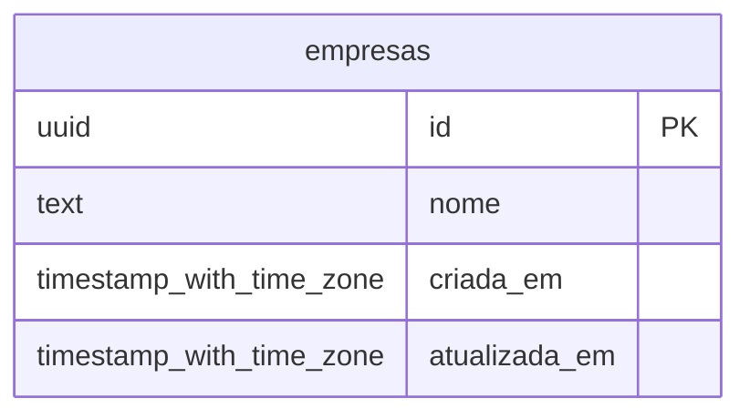

# Banco de dados

> Gerado sozinho por `pnpm banco:documentar` a partir das migrações (`nucleo/migracoes`). Não edite à mão:
> mude a migração e gere de novo. O porquê das escolhas está em [decisoes.md](decisoes.md).

## Diagrama

## Marcas

| Marca | Significa |
| --- | --- |
| `empresa` | Dado da empresa |
| `pessoal` | Dado pessoal (LGPD) |
| `sensivel` | Dado pessoal sensível (LGPD, art. 5º, II) |
| `sistema` | Controle técnico do sistema |

## Dicionário de dados

### empresas

Empresas que usam o Mago OS. Cada empresa só enxerga a própria linha; todas as outras tabelas de negócio apontam para cá pela coluna empresa_id.

Isolamento por empresa (Row Level Security): ligado e forçado.

| Coluna | Tipo | Obrigatória | Padrão | Marca | Descrição |
| --- | --- | --- | --- | --- | --- |
| id | uuid | sim | `uuidv7()` | sistema | Identificador da empresa (UUID v7, em ordem de criação). Chave primária. |
| nome | text | sim |  | empresa | Nome da empresa como aparece no sistema. |
| criada_em | timestamp with time zone | sim | `now()` | sistema | Quando a empresa foi cadastrada. |
| atualizada_em | timestamp with time zone | sim | `now()` | sistema | Última alteração no cadastro da empresa. |
