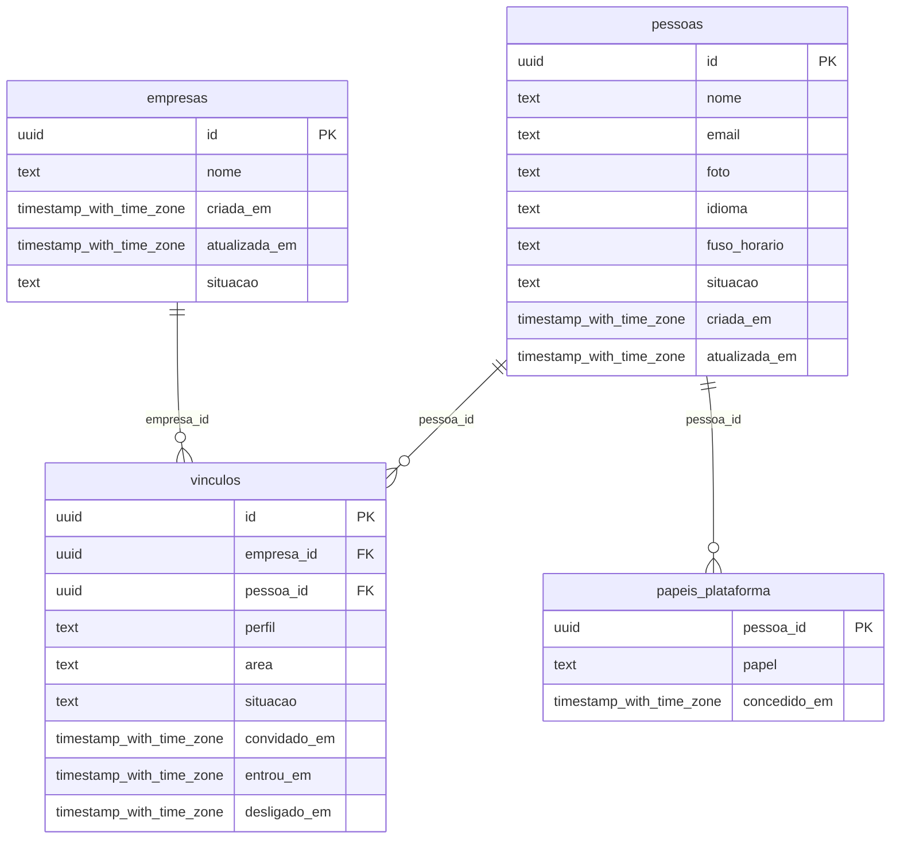

# Banco de dados

> Gerado sozinho por `pnpm banco:documentar` a partir das migrações (`nucleo/migracoes`). Não edite à mão:
> mude a migração e gere de novo. O porquê das escolhas está em [decisoes.md](decisoes.md).

## Diagrama

## Marcas

| Marca | Significa |
| --- | --- |
| `empresa` | Dado da empresa |
| `pessoal` | Dado pessoal (LGPD) |
| `sensivel` | Dado pessoal sensível (LGPD, art. 5º, II) |
| `sistema` | Controle técnico do sistema |

## Dicionário de dados

### empresas

Empresas que usam o Mago OS. Cada empresa só enxerga a própria linha; todas as outras tabelas de negócio apontam para cá pela coluna empresa_id.

Isolamento por empresa (Row Level Security): ligado e forçado.

| Coluna | Tipo | Obrigatória | Padrão | Marca | Descrição |
| --- | --- | --- | --- | --- | --- |
| id | uuid | sim | `uuidv7()` | sistema | Identificador da empresa (UUID v7, em ordem de criação). Chave primária. |
| nome | text | sim |  | empresa | Nome da empresa como aparece no sistema. |
| criada_em | timestamp with time zone | sim | `now()` | sistema | Quando a empresa foi cadastrada. |
| atualizada_em | timestamp with time zone | sim | `now()` | sistema | Última alteração no cadastro da empresa. |
| situacao | text | sim | `'ativa'::text` | sistema | ativa: funciona normalmente. suspensa: ninguém da empresa entra e nenhum dado dela aparece. |

### papeis_plataforma

Papéis acima das empresas. Na Fase 1 só existe o Dono da plataforma; o revendedor entra na Fase 2. Ter um papel aqui não abre os dados de nenhuma empresa.

Isolamento por empresa (Row Level Security): ligado e forçado.

| Coluna | Tipo | Obrigatória | Padrão | Marca | Descrição |
| --- | --- | --- | --- | --- | --- |
| pessoa_id | uuid | sim |  | sistema | Pessoa que tem o papel. Chave primária. |
| papel | text | sim |  | sistema | dono: Dono da plataforma. |
| concedido_em | timestamp with time zone | sim | `now()` | sistema | Quando o papel foi dado. |

### pessoas

Pessoas que fazem login. Um e-mail é uma pessoa só no sistema inteiro; a ligação com cada empresa fica em vinculos. Não tem empresa_id: a pessoa aparece em cada empresa onde tem vínculo.

Isolamento por empresa (Row Level Security): ligado e forçado.

| Coluna | Tipo | Obrigatória | Padrão | Marca | Descrição |
| --- | --- | --- | --- | --- | --- |
| id | uuid | sim | `uuidv7()` | sistema | Identificador da pessoa (UUID v7). Chave primária. |
| nome | text | sim |  | pessoal | Nome como aparece no sistema. |
| email | text | sim |  | pessoal | E-mail de login, em minúsculas e único no sistema. |
| foto | text | não |  | pessoal | Endereço https da foto, quando houver. |
| idioma | text | sim | `'pt-BR'::text` | pessoal | Idioma preferido (ex.: pt-BR). |
| fuso_horario | text | sim | `'America/Sao_Paulo'::text` | pessoal | Fuso horário IANA (ex.: Europe/Lisbon). |
| situacao | text | sim | `'ativa'::text` | sistema | ativa: pode entrar. bloqueada: não entra em nenhuma empresa. |
| criada_em | timestamp with time zone | sim | `now()` | sistema | Quando a pessoa foi cadastrada. |
| atualizada_em | timestamp with time zone | sim | `now()` | sistema | Última alteração no cadastro da pessoa. |

### vinculos

Uma pessoa dentro de uma empresa, com perfil e situação. A mesma pessoa tem um vínculo por empresa, cada um com as próprias permissões.

Isolamento por empresa (Row Level Security): ligado e forçado.

| Coluna | Tipo | Obrigatória | Padrão | Marca | Descrição |
| --- | --- | --- | --- | --- | --- |
| id | uuid | sim | `uuidv7()` | sistema | Identificador do vínculo (UUID v7). Chave primária. |
| empresa_id | uuid | sim |  | sistema | Empresa do vínculo. Aponta para empresas.id. |
| pessoa_id | uuid | sim |  | sistema | Pessoa do vínculo. Aponta para pessoas.id. |
| perfil | text | sim |  | empresa | administrador, gestor_area ou funcionario. |
| area | text | não |  | empresa | Área que o gestor cuida (ex.: comercial). Só o gestor de área tem. |
| situacao | text | sim | `'convidado'::text` | sistema | convidado: ainda não aceitou. ativo: trabalha na empresa. desligado: perdeu o acesso. |
| convidado_em | timestamp with time zone | sim | `now()` | sistema | Quando a pessoa foi convidada. |
| entrou_em | timestamp with time zone | não |  | sistema | Quando a pessoa aceitou o convite. |
| desligado_em | timestamp with time zone | não |  | sistema | Quando a pessoa foi desligada (ou o convite foi cancelado). |
