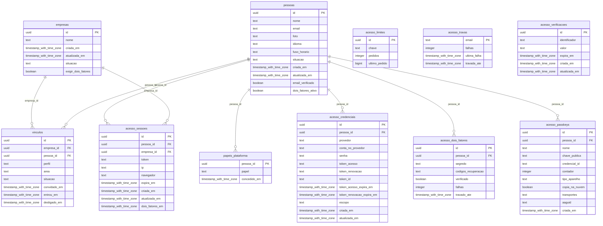

# Banco de dados

> Gerado sozinho por `pnpm banco:documentar` a partir das migrações (`nucleo/migracoes`). Não edite à mão:
> mude a migração e gere de novo. O porquê das escolhas está em [decisoes.md](decisoes.md).

## Diagrama

## Marcas

| Marca | Significa |
| --- | --- |
| `empresa` | Dado da empresa |
| `pessoal` | Dado pessoal (LGPD) |
| `sensivel` | Dado pessoal sensível (LGPD, art. 5º, II) |
| `sistema` | Controle técnico do sistema |

## Dicionário de dados

### empresas

Empresas que usam o Mago OS. Cada empresa só enxerga a própria linha; todas as outras tabelas de negócio apontam para cá pela coluna empresa_id.

Isolamento por empresa (Row Level Security): ligado e forçado.

| Coluna | Tipo | Obrigatória | Padrão | Marca | Descrição |
| --- | --- | --- | --- | --- | --- |
| id | uuid | sim | `uuidv7()` | sistema | Identificador da empresa (UUID v7, em ordem de criação). Chave primária. |
| nome | text | sim |  | empresa | Nome da empresa como aparece no sistema. |
| criada_em | timestamp with time zone | sim | `now()` | sistema | Quando a empresa foi cadastrada. |
| atualizada_em | timestamp with time zone | sim | `now()` | sistema | Última alteração no cadastro da empresa. |
| situacao | text | sim | `'ativa'::text` | sistema | ativa: funciona normalmente. suspensa: ninguém da empresa entra e nenhum dado dela aparece. |
| exigir_dois_fatores | boolean | sim | `false` | empresa | Se o administrador exigiu o 2FA de todas as pessoas da empresa (para administradores ele é sempre obrigatório). |

### papeis_plataforma

Papéis acima das empresas. Na Fase 1 só existe o Dono da plataforma; o revendedor entra na Fase 2. Ter um papel aqui não abre os dados de nenhuma empresa.

Isolamento por empresa (Row Level Security): ligado e forçado.

| Coluna | Tipo | Obrigatória | Padrão | Marca | Descrição |
| --- | --- | --- | --- | --- | --- |
| pessoa_id | uuid | sim |  | sistema | Pessoa que tem o papel. Chave primária. |
| papel | text | sim |  | sistema | dono: Dono da plataforma. |
| concedido_em | timestamp with time zone | sim | `now()` | sistema | Quando o papel foi dado. |

### pessoas

Pessoas que fazem login. Um e-mail é uma pessoa só no sistema inteiro; a ligação com cada empresa fica em vinculos. Não tem empresa_id: a pessoa aparece em cada empresa onde tem vínculo.

Isolamento por empresa (Row Level Security): ligado e forçado.

| Coluna | Tipo | Obrigatória | Padrão | Marca | Descrição |
| --- | --- | --- | --- | --- | --- |
| id | uuid | sim | `uuidv7()` | sistema | Identificador da pessoa (UUID v7). Chave primária. |
| nome | text | sim |  | pessoal | Nome como aparece no sistema. |
| email | text | sim |  | pessoal | E-mail de login, em minúsculas e único no sistema. |
| foto | text | não |  | pessoal | Endereço https da foto, quando houver. |
| idioma | text | sim | `'pt-BR'::text` | pessoal | Idioma preferido (ex.: pt-BR). |
| fuso_horario | text | sim | `'America/Sao_Paulo'::text` | pessoal | Fuso horário IANA (ex.: Europe/Lisbon). |
| situacao | text | sim | `'ativa'::text` | sistema | ativa: pode entrar. bloqueada: não entra em nenhuma empresa. |
| criada_em | timestamp with time zone | sim | `now()` | sistema | Quando a pessoa foi cadastrada. |
| atualizada_em | timestamp with time zone | sim | `now()` | sistema | Última alteração no cadastro da pessoa. |
| email_verificado | boolean | sim | `false` | sistema | Se o e-mail já foi confirmado (pelo convite, pelo Google ou por um link enviado a ele). |
| dois_fatores_ativo | boolean | sim | `false` | sistema | Se a pessoa ativou o app autenticador (o código é pedido a cada login, fora dos aparelhos confiáveis). |

### vinculos

Uma pessoa dentro de uma empresa, com perfil e situação. A mesma pessoa tem um vínculo por empresa, cada um com as próprias permissões.

Isolamento por empresa (Row Level Security): ligado e forçado.

| Coluna | Tipo | Obrigatória | Padrão | Marca | Descrição |
| --- | --- | --- | --- | --- | --- |
| id | uuid | sim | `uuidv7()` | sistema | Identificador do vínculo (UUID v7). Chave primária. |
| empresa_id | uuid | sim |  | sistema | Empresa do vínculo. Aponta para empresas.id. |
| pessoa_id | uuid | sim |  | sistema | Pessoa do vínculo. Aponta para pessoas.id. |
| perfil | text | sim |  | empresa | administrador, gestor_area ou funcionario. |
| area | text | não |  | empresa | Área que o gestor cuida (ex.: comercial). Só o gestor de área tem. |
| situacao | text | sim | `'convidado'::text` | sistema | convidado: ainda não aceitou. ativo: trabalha na empresa. desligado: perdeu o acesso. |
| convidado_em | timestamp with time zone | sim | `now()` | sistema | Quando a pessoa foi convidada. |
| entrou_em | timestamp with time zone | não |  | sistema | Quando a pessoa aceitou o convite. |
| desligado_em | timestamp with time zone | não |  | sistema | Quando a pessoa foi desligada (ou o convite foi cancelado). |

### acesso.credenciais

Formas de entrar de cada pessoa: senha (provedor "credential") e, a partir do M1-04, Google.

Isolamento por empresa (Row Level Security): fora das empresas (esquema acesso, só o papel mago_acesso mexe).

| Coluna | Tipo | Obrigatória | Padrão | Marca | Descrição |
| --- | --- | --- | --- | --- | --- |
| id | uuid | sim | `uuidv7()` | sistema | Identificador da credencial (UUID v7). Chave primária. |
| pessoa_id | uuid | sim |  | sistema | Pessoa dona da credencial. Aponta para pessoas.id. |
| provedor | text | sim |  | sistema | credential (e-mail e senha) ou o nome do provedor, como google. |
| conta_no_provedor | text | sim |  | pessoal | Identificador da pessoa no provedor. |
| senha | text | não |  | sensivel | Senha embaralhada sem volta (scrypt). Nunca a senha em si. |
| token_acesso | text | não |  | sensivel | Token de acesso do provedor externo, quando houver. |
| token_renovacao | text | não |  | sensivel | Token de renovação do provedor externo, quando houver. |
| token_id | text | não |  | sensivel | Token de identidade do provedor externo, quando houver. |
| token_acesso_expira_em | timestamp with time zone | não |  | sistema | Quando o token de acesso expira. |
| token_renovacao_expira_em | timestamp with time zone | não |  | sistema | Quando o token de renovação expira. |
| escopo | text | não |  | sistema | Permissões pedidas ao provedor externo. |
| criada_em | timestamp with time zone | sim | `now()` | sistema | Quando a credencial foi criada. |
| atualizada_em | timestamp with time zone | sim | `now()` | sistema | Última alteração da credencial. |

### acesso.dois_fatores

App autenticador de cada pessoa: segredo e códigos de recuperação, criptografados.

Isolamento por empresa (Row Level Security): fora das empresas (esquema acesso, só o papel mago_acesso mexe).

| Coluna | Tipo | Obrigatória | Padrão | Marca | Descrição |
| --- | --- | --- | --- | --- | --- |
| id | uuid | sim | `uuidv7()` | sistema | Identificador (UUID v7). Chave primária. |
| pessoa_id | uuid | sim |  | sistema | Pessoa dona do app autenticador. Aponta para pessoas.id. |
| segredo | text | sim |  | sensivel | Segredo do app autenticador, criptografado com o segredo do login. |
| codigos_recuperacao | text | sim |  | sensivel | Os 10 códigos de recuperação de uso único, criptografados. |
| verificado | boolean | sim | `false` | sistema | Se a pessoa já confirmou o app com um código (antes disso, o 2FA não vale). |
| falhas | integer | sim | `0` | sistema | Códigos errados seguidos. |
| travado_ate | timestamp with time zone | não |  | sistema | Até quando os códigos ficam travados depois de muitos erros. |

### acesso.limites

Contagem de pedidos por endereço de internet, para limitar tentativas por minuto.

Isolamento por empresa (Row Level Security): fora das empresas (esquema acesso, só o papel mago_acesso mexe).

| Coluna | Tipo | Obrigatória | Padrão | Marca | Descrição |
| --- | --- | --- | --- | --- | --- |
| id | uuid | sim | `uuidv7()` | sistema | Identificador da contagem. Chave primária. |
| chave | text | sim |  | pessoal | IP e caminho pedido. |
| pedidos | integer | sim |  | sistema | Quantos pedidos dentro da janela atual. |
| ultimo_pedido | bigint | sim |  | sistema | Hora do último pedido, em milissegundos. |

### acesso.passkeys

Passkeys de cada pessoa (Face ID, Touch ID, digital, chave física). Só a parte pública da chave fica aqui.

Isolamento por empresa (Row Level Security): fora das empresas (esquema acesso, só o papel mago_acesso mexe).

| Coluna | Tipo | Obrigatória | Padrão | Marca | Descrição |
| --- | --- | --- | --- | --- | --- |
| id | uuid | sim | `uuidv7()` | sistema | Identificador (UUID v7). Chave primária. |
| pessoa_id | uuid | sim |  | sistema | Pessoa dona da passkey. Aponta para pessoas.id. |
| nome | text | não |  | pessoal | Nome dado à passkey (ex.: MacBook do Sandro). |
| chave_publica | text | sim |  | sistema | Chave pública da passkey: confere a assinatura, não serve para entrar. |
| credencial_id | text | sim |  | sistema | Identificador da passkey no aparelho. |
| contador | integer | sim | `0` | sistema | Contador de uso, que ajuda a perceber uma passkey copiada. |
| tipo_aparelho | text | sim |  | sistema | singleDevice (só neste aparelho) ou multiDevice (sincronizada). |
| copia_na_nuvem | boolean | sim | `false` | sistema | Se a passkey tem cópia sincronizada (iCloud, Google). |
| transportes | text | não |  | sistema | Como o aparelho se conecta (interno, USB, NFC, Bluetooth). |
| aaguid | text | não |  | sistema | Modelo do autenticador (não identifica a pessoa nem o aparelho). |
| criada_em | timestamp with time zone | sim | `now()` | sistema | Quando a passkey foi cadastrada. |

### acesso.sessoes

Aparelhos conectados. Cada linha é uma sessão aberta; apagar a linha desconecta o aparelho na hora.

Isolamento por empresa (Row Level Security): fora das empresas (esquema acesso, só o papel mago_acesso mexe).

| Coluna | Tipo | Obrigatória | Padrão | Marca | Descrição |
| --- | --- | --- | --- | --- | --- |
| id | uuid | sim | `uuidv7()` | sistema | Identificador da sessão (UUID v7). Chave primária. |
| pessoa_id | uuid | sim |  | sistema | Pessoa da sessão. Aponta para pessoas.id. |
| empresa_id | uuid | não |  | sistema | Empresa ativa nesta sessão (nula enquanto a pessoa não escolhe). Aponta para empresas.id. |
| token | text | sim |  | sensivel | Token da sessão, que vai assinado no cookie. |
| ip | text | não |  | pessoal | IP de onde a sessão foi aberta. |
| navegador | text | não |  | pessoal | Navegador e sistema do aparelho (user agent). |
| expira_em | timestamp with time zone | sim |  | sistema | Quando a sessão deixa de valer. |
| criada_em | timestamp with time zone | sim | `now()` | sistema | Quando a pessoa entrou. |
| atualizada_em | timestamp with time zone | sim | `now()` | sistema | Última renovação da sessão. |
| dois_fatores_em | timestamp with time zone | não |  | sistema | Última vez que esta sessão passou pelo segundo fator (código, código de recuperação ou passkey). |

### acesso.travas

Senhas erradas seguidas por e-mail. Na quinta seguida, o e-mail trava por 15 minutos. Vale também para e-mails sem conta, para não revelar quais existem.

Isolamento por empresa (Row Level Security): fora das empresas (esquema acesso, só o papel mago_acesso mexe).

| Coluna | Tipo | Obrigatória | Padrão | Marca | Descrição |
| --- | --- | --- | --- | --- | --- |
| email | text | sim |  | pessoal | E-mail tentado, em minúsculas. Chave primária. |
| falhas | integer | sim | `0` | sistema | Senhas erradas seguidas desde o último acerto. |
| ultima_falha | timestamp with time zone | sim | `now()` | sistema | Quando foi a última senha errada. |
| travada_ate | timestamp with time zone | não |  | sistema | Até quando o e-mail fica travado, se estiver. |

### acesso.verificacoes

Links de uso único (recuperar senha, confirmar e-mail), cada um com validade curta.

Isolamento por empresa (Row Level Security): fora das empresas (esquema acesso, só o papel mago_acesso mexe).

| Coluna | Tipo | Obrigatória | Padrão | Marca | Descrição |
| --- | --- | --- | --- | --- | --- |
| id | uuid | sim | `uuidv7()` | sistema | Identificador do link (UUID v7). Chave primária. |
| identificador | text | sim |  | sensivel | Código do link, que só existe no e-mail enviado. |
| valor | text | sim |  | sistema | A quem o link se refere (identificador da pessoa). |
| expira_em | timestamp with time zone | sim |  | sistema | Até quando o link vale. |
| criada_em | timestamp with time zone | sim | `now()` | sistema | Quando o link foi criado. |
| atualizada_em | timestamp with time zone | sim | `now()` | sistema | Última alteração do link. |
