# Banco de dados

> Gerado sozinho por `pnpm banco:documentar` a partir das migrações (`nucleo/migracoes`). Não edite à mão:
> mude a migração e gere de novo. O porquê das escolhas está em [decisoes.md](decisoes.md).

## Diagrama

```mermaid
erDiagram
  ajustes_de_permissao {
    uuid id PK
    uuid empresa_id FK
    uuid vinculo_id FK
    text modulo
    text acao
    text alcance
    uuid feito_por FK
    timestamp_with_time_zone feito_em
  }
  empresas {
    uuid id PK
    text nome
    timestamp_with_time_zone criada_em
    timestamp_with_time_zone atualizada_em
    text situacao
    boolean exigir_dois_fatores
    boolean exigir_passkey
    text tipo
    text documento
    text nome_legal
    text fuso_horario
    text idioma
    text telefone
  }
  papeis_plataforma {
    uuid pessoa_id PK
    text papel
    timestamp_with_time_zone concedido_em
  }
  pessoas {
    uuid id PK
    text nome
    text email
    text foto
    text idioma
    text fuso_horario
    text situacao
    timestamp_with_time_zone criada_em
    timestamp_with_time_zone atualizada_em
    boolean email_verificado
    boolean dois_fatores_ativo
  }
  vinculos {
    uuid id PK
    uuid empresa_id FK
    uuid pessoa_id FK
    text perfil
    text area
    text situacao
    timestamp_with_time_zone convidado_em
    timestamp_with_time_zone entrou_em
    timestamp_with_time_zone desligado_em
  }
  auditoria_correntes {
    uuid corrente PK
    bigint ultima_sequencia
    text ultimo_hash
  }
  auditoria_eventos {
    uuid id PK
    uuid empresa_id FK
    uuid corrente
    bigint sequencia
    jsonb ator
    text acao
    jsonb alvo
    jsonb origem
    timestamp_with_time_zone ocorrido_em
    text rastreio
    jsonb detalhes
    text hash_anterior
    text hash
    timestamp_with_time_zone copiado_em
  }
  acesso_aparelhos {
    uuid id PK
    uuid pessoa_id FK
    text etiqueta
    text nome
    timestamp_with_time_zone primeiro_acesso
    timestamp_with_time_zone ultimo_acesso
  }
  acesso_avisos {
    uuid id PK
    uuid pessoa_id FK
    text tipo
    uuid aparelho_id FK
    text aparelho_nome
    text ip
    timestamp_with_time_zone criado_em
    timestamp_with_time_zone respondido_em
    text resposta
  }
  acesso_convites {
    uuid id PK
    uuid empresa_id FK
    uuid vinculo_id FK
    uuid pessoa_id FK
    text codigo
    uuid convidado_por FK
    timestamp_with_time_zone criado_em
    timestamp_with_time_zone expira_em
    timestamp_with_time_zone usado_em
    timestamp_with_time_zone cancelado_em
  }
  acesso_convites_de_empresa {
    uuid id PK
    text nome
    text email
    text codigo
    uuid convidado_por FK
    timestamp_with_time_zone criado_em
    timestamp_with_time_zone expira_em
    timestamp_with_time_zone usado_em
    timestamp_with_time_zone cancelado_em
    uuid empresa_id FK
  }
  acesso_credenciais {
    uuid id PK
    uuid pessoa_id FK
    text provedor
    text conta_no_provedor
    text senha
    text token_acesso
    text token_renovacao
    text token_id
    timestamp_with_time_zone token_acesso_expira_em
    timestamp_with_time_zone token_renovacao_expira_em
    text escopo
    timestamp_with_time_zone criada_em
    timestamp_with_time_zone atualizada_em
  }
  acesso_dois_fatores {
    uuid id PK
    uuid pessoa_id FK
    text segredo
    text codigos_recuperacao
    boolean verificado
    integer falhas
    timestamp_with_time_zone travado_ate
  }
  acesso_limites {
    uuid id PK
    text chave
    integer pedidos
    bigint ultimo_pedido
  }
  acesso_passkeys {
    uuid id PK
    uuid pessoa_id FK
    text nome
    text chave_publica
    text credencial_id
    integer contador
    text tipo_aparelho
    boolean copia_na_nuvem
    text transportes
    text aaguid
    timestamp_with_time_zone criada_em
  }
  acesso_regras_da_plataforma {
    boolean unica PK
    boolean exigir_passkey_administradores
  }
  acesso_sessoes {
    uuid id PK
    uuid pessoa_id FK
    uuid empresa_id FK
    text token
    text ip
    text navegador
    timestamp_with_time_zone expira_em
    timestamp_with_time_zone criada_em
    timestamp_with_time_zone atualizada_em
    timestamp_with_time_zone dois_fatores_em
    text dois_fatores_metodo
    uuid aparelho_id FK
    timestamp_with_time_zone ultimo_uso_em
  }
  acesso_travas {
    text email PK
    integer falhas
    timestamp_with_time_zone ultima_falha
    timestamp_with_time_zone travada_ate
  }
  acesso_verificacoes {
    uuid id PK
    text identificador
    text valor
    timestamp_with_time_zone expira_em
    timestamp_with_time_zone criada_em
    timestamp_with_time_zone atualizada_em
  }
  empresas ||--o{ ajustes_de_permissao : "empresa_id"
  vinculos ||--o{ ajustes_de_permissao : "vinculo_id"
  pessoas ||--o{ ajustes_de_permissao : "feito_por"
  pessoas ||--o{ papeis_plataforma : "pessoa_id"
  empresas ||--o{ vinculos : "empresa_id"
  pessoas ||--o{ vinculos : "pessoa_id"
  empresas ||--o{ auditoria_eventos : "empresa_id"
  pessoas ||--o{ acesso_aparelhos : "pessoa_id"
  pessoas ||--o{ acesso_avisos : "pessoa_id"
  acesso_aparelhos ||--o{ acesso_avisos : "aparelho_id"
  empresas ||--o{ acesso_convites : "empresa_id"
  vinculos ||--o{ acesso_convites : "vinculo_id"
  pessoas ||--o{ acesso_convites : "pessoa_id"
  pessoas ||--o{ acesso_convites : "convidado_por"
  pessoas ||--o{ acesso_convites_de_empresa : "convidado_por"
  empresas ||--o{ acesso_convites_de_empresa : "empresa_id"
  pessoas ||--o{ acesso_credenciais : "pessoa_id"
  pessoas ||--o{ acesso_dois_fatores : "pessoa_id"
  pessoas ||--o{ acesso_passkeys : "pessoa_id"
  pessoas ||--o{ acesso_sessoes : "pessoa_id"
  empresas ||--o{ acesso_sessoes : "empresa_id"
  acesso_aparelhos ||--o{ acesso_sessoes : "aparelho_id"
```

## Marcas

| Marca | Significa |
| --- | --- |
| `empresa` | Dado da empresa |
| `pessoal` | Dado pessoal (LGPD) |
| `sensivel` | Dado pessoal sensível (LGPD, art. 5º, II) |
| `sistema` | Controle técnico do sistema |

## Dicionário de dados

### ajustes_de_permissao

Ajustes que o administrador faz nas permissões de uma pessoa, por módulo e ação, por cima do perfil dela.

Isolamento por empresa (Row Level Security): ligado e forçado.

| Coluna | Tipo | Obrigatória | Padrão | Marca | Descrição |
| --- | --- | --- | --- | --- | --- |
| id | uuid | sim | `uuidv7()` | sistema | Identificador do ajuste (UUID v7). Chave primária. |
| empresa_id | uuid | sim |  | sistema | Empresa do ajuste. Aponta para empresas.id. |
| vinculo_id | uuid | sim |  | sistema | Vínculo (pessoa na empresa) ajustado. Aponta para vinculos.id. |
| modulo | text | sim |  | empresa | Módulo ajustado (ex.: crm, pessoas). |
| acao | text | sim |  | empresa | Ação ajustada: ver, criar, editar, aprovar, excluir ou ver_sensiveis. |
| alcance | text | sim |  | empresa | Alcance dado: nada, meus (itens), equipe ou tudo. |
| feito_por | uuid | sim |  | sistema | Pessoa que fez o ajuste. Aponta para pessoas.id. |
| feito_em | timestamp with time zone | sim | `now()` | sistema | Quando o ajuste foi feito. |

### empresas

Empresas que usam o Mago OS. Cada empresa só enxerga a própria linha; todas as outras tabelas de negócio apontam para cá pela coluna empresa_id.

Isolamento por empresa (Row Level Security): ligado e forçado.

| Coluna | Tipo | Obrigatória | Padrão | Marca | Descrição |
| --- | --- | --- | --- | --- | --- |
| id | uuid | sim | `uuidv7()` | sistema | Identificador da empresa (UUID v7, em ordem de criação). Chave primária. |
| nome | text | sim |  | empresa | Nome da empresa como aparece no sistema. |
| criada_em | timestamp with time zone | sim | `now()` | sistema | Quando a empresa foi cadastrada. |
| atualizada_em | timestamp with time zone | sim | `now()` | sistema | Última alteração no cadastro da empresa. |
| situacao | text | sim | `'ativa'::text` | sistema | ativa: funciona normalmente. suspensa: ninguém da empresa entra e nenhum dado dela aparece. |
| exigir_dois_fatores | boolean | sim | `false` | empresa | Se o administrador exigiu o 2FA de todas as pessoas da empresa (para administradores ele é sempre obrigatório). |
| exigir_passkey | boolean | sim | `false` | empresa | Se o administrador exigiu passkey de todas as pessoas da empresa (o código do app deixa de valer sozinho). |
| tipo | text | não |  | empresa | pj: empresa com CNPJ. pf: pessoa física com CPF. Vazio nas contas criadas antes da M1-11. |
| documento | text | não |  | pessoal | CNPJ ou CPF, sem pontuação. Um documento, uma conta. O CPF é dado pessoal: aparece mascarado para quem não é administrador nem Dono. |
| nome_legal | text | não |  | empresa | Razão social (CNPJ) ou nome completo (CPF). |
| fuso_horario | text | sim | `'America/Sao_Paulo'::text` | empresa | Fuso horário IANA da conta (ex.: America/Sao_Paulo). |
| idioma | text | sim | `'pt-BR'::text` | empresa | Idioma da conta (ex.: pt-BR). |
| telefone | text | não |  | empresa | Telefone de contato da conta (opcional). |

### papeis_plataforma

Papéis acima das empresas. Na Fase 1 só existe o Dono da plataforma; o revendedor entra na Fase 2. Ter um papel aqui não abre os dados de nenhuma empresa.

Isolamento por empresa (Row Level Security): ligado e forçado.

| Coluna | Tipo | Obrigatória | Padrão | Marca | Descrição |
| --- | --- | --- | --- | --- | --- |
| pessoa_id | uuid | sim |  | sistema | Pessoa que tem o papel. Chave primária. |
| papel | text | sim |  | sistema | dono: Dono da plataforma. |
| concedido_em | timestamp with time zone | sim | `now()` | sistema | Quando o papel foi dado. |

### pessoas

Pessoas que fazem login. Um e-mail é uma pessoa só no sistema inteiro; a ligação com cada empresa fica em vinculos. Não tem empresa_id: a pessoa aparece em cada empresa onde tem vínculo.

Isolamento por empresa (Row Level Security): ligado e forçado.

| Coluna | Tipo | Obrigatória | Padrão | Marca | Descrição |
| --- | --- | --- | --- | --- | --- |
| id | uuid | sim | `uuidv7()` | sistema | Identificador da pessoa (UUID v7). Chave primária. |
| nome | text | sim |  | pessoal | Nome como aparece no sistema. |
| email | text | sim |  | pessoal | E-mail de login, em minúsculas e único no sistema. |
| foto | text | não |  | pessoal | Endereço https da foto, quando houver. |
| idioma | text | sim | `'pt-BR'::text` | pessoal | Idioma preferido (ex.: pt-BR). |
| fuso_horario | text | sim | `'America/Sao_Paulo'::text` | pessoal | Fuso horário IANA (ex.: Europe/Lisbon). |
| situacao | text | sim | `'ativa'::text` | sistema | ativa: pode entrar. bloqueada: não entra em nenhuma empresa. |
| criada_em | timestamp with time zone | sim | `now()` | sistema | Quando a pessoa foi cadastrada. |
| atualizada_em | timestamp with time zone | sim | `now()` | sistema | Última alteração no cadastro da pessoa. |
| email_verificado | boolean | sim | `false` | sistema | Se o e-mail já foi confirmado (pelo convite, pelo Google ou por um link enviado a ele). |
| dois_fatores_ativo | boolean | sim | `false` | sistema | Se a pessoa ativou o app autenticador (o código é pedido a cada login, fora dos aparelhos confiáveis). |

### vinculos

Uma pessoa dentro de uma empresa, com perfil e situação. A mesma pessoa tem um vínculo por empresa, cada um com as próprias permissões.

Isolamento por empresa (Row Level Security): ligado e forçado.

| Coluna | Tipo | Obrigatória | Padrão | Marca | Descrição |
| --- | --- | --- | --- | --- | --- |
| id | uuid | sim | `uuidv7()` | sistema | Identificador do vínculo (UUID v7). Chave primária. |
| empresa_id | uuid | sim |  | sistema | Empresa do vínculo. Aponta para empresas.id. |
| pessoa_id | uuid | sim |  | sistema | Pessoa do vínculo. Aponta para pessoas.id. |
| perfil | text | sim |  | empresa | administrador, gestor_area ou funcionario. |
| area | text | não |  | empresa | Área da pessoa (ex.: comercial). O gestor cuida dela; o funcionário faz parte dela (a equipe); o administrador não tem. |
| situacao | text | sim | `'convidado'::text` | sistema | convidado: ainda não aceitou. ativo: trabalha na empresa. desligado: perdeu o acesso. |
| convidado_em | timestamp with time zone | sim | `now()` | sistema | Quando a pessoa foi convidada. |
| entrou_em | timestamp with time zone | não |  | sistema | Quando a pessoa aceitou o convite. |
| desligado_em | timestamp with time zone | não |  | sistema | Quando a pessoa foi desligada (ou o convite foi cancelado). |

### auditoria.correntes

Ponta de cada corrente: a última posição e a última impressão digital.

Isolamento por empresa (Row Level Security): esquema auditoria (só as funções de gravação mexem).

| Coluna | Tipo | Obrigatória | Padrão | Marca | Descrição |
| --- | --- | --- | --- | --- | --- |
| corrente | uuid | sim |  | sistema | Empresa da corrente (zeros para a plataforma). Chave primária. |
| ultima_sequencia | bigint | sim | `0` | sistema | Posição do último evento gravado. |
| ultimo_hash | text | não |  | sistema | Impressão digital do último evento gravado. |

### auditoria.eventos

Eventos de auditoria, encadeados por empresa (contrato EventoAuditoria). Só acrescenta.

Isolamento por empresa (Row Level Security): ligado e forçado (cada empresa lê só os próprios eventos; só acrescenta).

| Coluna | Tipo | Obrigatória | Padrão | Marca | Descrição |
| --- | --- | --- | --- | --- | --- |
| id | uuid | sim |  | sistema | Identificador do evento. Chave primária. |
| empresa_id | uuid | não |  | sistema | Empresa do evento (nula: evento da plataforma). Aponta para empresas.id. |
| corrente | uuid | não | `auditoria.corrente_de(empresa_id)` | sistema | Corrente do evento (a empresa, ou zeros para a plataforma). |
| sequencia | bigint | sim |  | sistema | Posição na corrente, começando em 1. |
| ator | jsonb | sim |  | pessoal | Quem fez: pessoa, agente ou sistema. |
| acao | text | sim |  | sistema | Ação no formato assunto.verbo (ex.: acesso.entrou). |
| alvo | jsonb | não |  | sistema | Item afetado (tipo e identificador). |
| origem | jsonb | sim |  | pessoal | De onde: canal, IP e aparelho. |
| ocorrido_em | timestamp with time zone | sim |  | sistema | Quando aconteceu. |
| rastreio | text | não |  | sistema | Número de rastreio do pedido. |
| detalhes | jsonb | sim | `'{}'::jsonb` | pessoal | Informações extras da ação. Nunca senha, token, código ou dado sensível. |
| hash_anterior | text | não |  | sistema | Impressão digital do evento anterior da corrente. |
| hash | text | sim |  | sistema | Impressão digital (SHA-256) deste evento. |
| copiado_em | timestamp with time zone | não |  | sistema | Quando o evento foi para a cópia travada no Backblaze. |

### acesso.aparelhos

Aparelhos que cada pessoa já usou para entrar, reconhecidos por uma etiqueta guardada num cookie do aparelho.

Isolamento por empresa (Row Level Security): fora das empresas (esquema acesso, só o papel mago_acesso mexe).

| Coluna | Tipo | Obrigatória | Padrão | Marca | Descrição |
| --- | --- | --- | --- | --- | --- |
| id | uuid | sim | `uuidv7()` | sistema | Identificador do aparelho (UUID v7). Chave primária. |
| pessoa_id | uuid | sim |  | sistema | Pessoa que usa o aparelho. Aponta para pessoas.id. |
| etiqueta | text | sim |  | sistema | Impressão digital (SHA-256) da etiqueta do aparelho. A etiqueta em si só existe no cookie. |
| nome | text | sim |  | pessoal | Nome legível do aparelho (ex.: Chrome no Mac). |
| primeiro_acesso | timestamp with time zone | sim | `now()` | sistema | Primeira vez que a pessoa entrou por este aparelho. |
| ultimo_acesso | timestamp with time zone | sim | `now()` | sistema | Última vez que a pessoa entrou por este aparelho. |

### acesso.avisos

Avisos de segurança para a própria pessoa, como um acesso por aparelho novo.

Isolamento por empresa (Row Level Security): fora das empresas (esquema acesso, só o papel mago_acesso mexe).

| Coluna | Tipo | Obrigatória | Padrão | Marca | Descrição |
| --- | --- | --- | --- | --- | --- |
| id | uuid | sim | `uuidv7()` | sistema | Identificador do aviso (UUID v7). Chave primária. |
| pessoa_id | uuid | sim |  | sistema | Pessoa avisada. Aponta para pessoas.id. |
| tipo | text | sim |  | sistema | Tipo do aviso: aparelho_novo. |
| aparelho_id | uuid | não |  | sistema | Aparelho do acesso avisado. Aponta para acesso.aparelhos.id. |
| aparelho_nome | text | sim |  | pessoal | Nome do aparelho no momento do aviso. |
| ip | text | não |  | pessoal | IP do acesso avisado. |
| criado_em | timestamp with time zone | sim | `now()` | sistema | Quando o acesso aconteceu. |
| respondido_em | timestamp with time zone | não |  | sistema | Quando a pessoa respondeu ao aviso. |
| resposta | text | não |  | sistema | foi_eu ou nao_fui_eu (este desconecta o aparelho). |

### acesso.convites

Convites para entrar numa empresa. O link vale 7 dias e funciona uma vez só.

Isolamento por empresa (Row Level Security): fora das empresas (esquema acesso, só o papel mago_acesso mexe).

| Coluna | Tipo | Obrigatória | Padrão | Marca | Descrição |
| --- | --- | --- | --- | --- | --- |
| id | uuid | sim | `uuidv7()` | sistema | Identificador do convite (UUID v7). Chave primária. |
| empresa_id | uuid | sim |  | sistema | Empresa do convite. Aponta para empresas.id. |
| vinculo_id | uuid | sim |  | sistema | Vínculo criado pelo convite (fica "convidado" até aceitar). Aponta para vinculos.id. |
| pessoa_id | uuid | sim |  | sistema | Pessoa convidada. Aponta para pessoas.id. |
| codigo | text | sim |  | sensivel | Impressão digital (SHA-256) do código do link. O código em si só existe no e-mail. |
| convidado_por | uuid | sim |  | sistema | Quem convidou. Aponta para pessoas.id. |
| criado_em | timestamp with time zone | sim | `now()` | sistema | Quando o convite foi enviado. |
| expira_em | timestamp with time zone | sim |  | sistema | Até quando o link vale. |
| usado_em | timestamp with time zone | não |  | sistema | Quando o convite foi aceito. |
| cancelado_em | timestamp with time zone | não |  | sistema | Quando o convite foi cancelado ou trocado por um novo. |

### acesso.convites_de_empresa

Convites do Dono para alguém criar uma conta nova no Mago OS. O link vale 7 dias e funciona uma vez só.

Isolamento por empresa (Row Level Security): fora das empresas (esquema acesso, só o papel mago_acesso mexe).

| Coluna | Tipo | Obrigatória | Padrão | Marca | Descrição |
| --- | --- | --- | --- | --- | --- |
| id | uuid | sim | `uuidv7()` | sistema | Identificador do convite (UUID v7). Chave primária. |
| nome | text | sim |  | pessoal | Nome do responsável pela conta nova. |
| email | text | sim |  | pessoal | E-mail do responsável (vira o login dele). |
| codigo | text | sim |  | sensivel | Impressão digital (SHA-256) do código do link. O código em si só existe no e-mail. |
| convidado_por | uuid | sim |  | sistema | Quem convidou (o Dono). Aponta para pessoas.id. |
| criado_em | timestamp with time zone | sim | `now()` | sistema | Quando o convite foi enviado. |
| expira_em | timestamp with time zone | sim |  | sistema | Até quando o link vale. |
| usado_em | timestamp with time zone | não |  | sistema | Quando a conta foi criada pelo link. |
| cancelado_em | timestamp with time zone | não |  | sistema | Quando o convite foi cancelado ou trocado por um novo. |
| empresa_id | uuid | não |  | sistema | Conta criada pelo convite. Aponta para empresas.id. |

### acesso.credenciais

Formas de entrar de cada pessoa: senha (provedor "credential") e, a partir do M1-04, Google.

Isolamento por empresa (Row Level Security): fora das empresas (esquema acesso, só o papel mago_acesso mexe).

| Coluna | Tipo | Obrigatória | Padrão | Marca | Descrição |
| --- | --- | --- | --- | --- | --- |
| id | uuid | sim | `uuidv7()` | sistema | Identificador da credencial (UUID v7). Chave primária. |
| pessoa_id | uuid | sim |  | sistema | Pessoa dona da credencial. Aponta para pessoas.id. |
| provedor | text | sim |  | sistema | credential (e-mail e senha) ou o nome do provedor, como google. |
| conta_no_provedor | text | sim |  | pessoal | Identificador da pessoa no provedor. |
| senha | text | não |  | sensivel | Senha embaralhada sem volta (scrypt). Nunca a senha em si. |
| token_acesso | text | não |  | sensivel | Token de acesso do provedor externo, quando houver. |
| token_renovacao | text | não |  | sensivel | Token de renovação do provedor externo, quando houver. |
| token_id | text | não |  | sensivel | Token de identidade do provedor externo, quando houver. |
| token_acesso_expira_em | timestamp with time zone | não |  | sistema | Quando o token de acesso expira. |
| token_renovacao_expira_em | timestamp with time zone | não |  | sistema | Quando o token de renovação expira. |
| escopo | text | não |  | sistema | Permissões pedidas ao provedor externo. |
| criada_em | timestamp with time zone | sim | `now()` | sistema | Quando a credencial foi criada. |
| atualizada_em | timestamp with time zone | sim | `now()` | sistema | Última alteração da credencial. |

### acesso.dois_fatores

App autenticador de cada pessoa: segredo e códigos de recuperação, criptografados.

Isolamento por empresa (Row Level Security): fora das empresas (esquema acesso, só o papel mago_acesso mexe).

| Coluna | Tipo | Obrigatória | Padrão | Marca | Descrição |
| --- | --- | --- | --- | --- | --- |
| id | uuid | sim | `uuidv7()` | sistema | Identificador (UUID v7). Chave primária. |
| pessoa_id | uuid | sim |  | sistema | Pessoa dona do app autenticador. Aponta para pessoas.id. |
| segredo | text | sim |  | sensivel | Segredo do app autenticador, criptografado com o segredo do login. |
| codigos_recuperacao | text | sim |  | sensivel | Os 10 códigos de recuperação de uso único, criptografados. |
| verificado | boolean | sim | `false` | sistema | Se a pessoa já confirmou o app com um código (antes disso, o 2FA não vale). |
| falhas | integer | sim | `0` | sistema | Códigos errados seguidos. |
| travado_ate | timestamp with time zone | não |  | sistema | Até quando os códigos ficam travados depois de muitos erros. |

### acesso.limites

Contagem de pedidos por endereço de internet, para limitar tentativas por minuto.

Isolamento por empresa (Row Level Security): fora das empresas (esquema acesso, só o papel mago_acesso mexe).

| Coluna | Tipo | Obrigatória | Padrão | Marca | Descrição |
| --- | --- | --- | --- | --- | --- |
| id | uuid | sim | `uuidv7()` | sistema | Identificador da contagem. Chave primária. |
| chave | text | sim |  | pessoal | IP e caminho pedido. |
| pedidos | integer | sim |  | sistema | Quantos pedidos dentro da janela atual. |
| ultimo_pedido | bigint | sim |  | sistema | Hora do último pedido, em milissegundos. |

### acesso.passkeys

Passkeys de cada pessoa (Face ID, Touch ID, digital, chave física). Só a parte pública da chave fica aqui.

Isolamento por empresa (Row Level Security): fora das empresas (esquema acesso, só o papel mago_acesso mexe).

| Coluna | Tipo | Obrigatória | Padrão | Marca | Descrição |
| --- | --- | --- | --- | --- | --- |
| id | uuid | sim | `uuidv7()` | sistema | Identificador (UUID v7). Chave primária. |
| pessoa_id | uuid | sim |  | sistema | Pessoa dona da passkey. Aponta para pessoas.id. |
| nome | text | não |  | pessoal | Nome dado à passkey (ex.: MacBook do Sandro). |
| chave_publica | text | sim |  | sistema | Chave pública da passkey: confere a assinatura, não serve para entrar. |
| credencial_id | text | sim |  | sistema | Identificador da passkey no aparelho. |
| contador | integer | sim | `0` | sistema | Contador de uso, que ajuda a perceber uma passkey copiada. |
| tipo_aparelho | text | sim |  | sistema | singleDevice (só neste aparelho) ou multiDevice (sincronizada). |
| copia_na_nuvem | boolean | sim | `false` | sistema | Se a passkey tem cópia sincronizada (iCloud, Google). |
| transportes | text | não |  | sistema | Como o aparelho se conecta (interno, USB, NFC, Bluetooth). |
| aaguid | text | não |  | sistema | Modelo do autenticador (não identifica a pessoa nem o aparelho). |
| criada_em | timestamp with time zone | sim | `now()` | sistema | Quando a passkey foi cadastrada. |

### acesso.regras_da_plataforma

Regras de segurança da plataforma inteira (uma linha só), decididas pelo Dono da plataforma. As empresas só podem apertar, nunca afrouxar.

Isolamento por empresa (Row Level Security): fora das empresas (esquema acesso, só o papel mago_acesso mexe).

| Coluna | Tipo | Obrigatória | Padrão | Marca | Descrição |
| --- | --- | --- | --- | --- | --- |
| unica | boolean | sim | `true` | sistema | Garante que exista uma linha só. Chave primária. |
| exigir_passkey_administradores | boolean | sim | `false` | sistema | Se administradores e o Dono da plataforma só confirmam com passkey (o código do app deixa de valer sozinho). |

### acesso.sessoes

Aparelhos conectados. Cada linha é uma sessão aberta; apagar a linha desconecta o aparelho na hora.

Isolamento por empresa (Row Level Security): fora das empresas (esquema acesso, só o papel mago_acesso mexe).

| Coluna | Tipo | Obrigatória | Padrão | Marca | Descrição |
| --- | --- | --- | --- | --- | --- |
| id | uuid | sim | `uuidv7()` | sistema | Identificador da sessão (UUID v7). Chave primária. |
| pessoa_id | uuid | sim |  | sistema | Pessoa da sessão. Aponta para pessoas.id. |
| empresa_id | uuid | não |  | sistema | Empresa ativa nesta sessão (nula enquanto a pessoa não escolhe). Aponta para empresas.id. |
| token | text | sim |  | sensivel | Token da sessão, que vai assinado no cookie. |
| ip | text | não |  | pessoal | IP de onde a sessão foi aberta. |
| navegador | text | não |  | pessoal | Navegador e sistema do aparelho (user agent). |
| expira_em | timestamp with time zone | sim |  | sistema | Quando a sessão deixa de valer. |
| criada_em | timestamp with time zone | sim | `now()` | sistema | Quando a pessoa entrou. |
| atualizada_em | timestamp with time zone | sim | `now()` | sistema | Última renovação da sessão. |
| dois_fatores_em | timestamp with time zone | não |  | sistema | Última vez que esta sessão passou pelo segundo fator (código, código de recuperação ou passkey). |
| dois_fatores_metodo | text | não |  | sistema | Como a sessão passou pelo segundo fator: passkey, app, recuperacao (código de recuperação) ou aparelho (confiável). |
| aparelho_id | uuid | não |  | sistema | Aparelho de onde a sessão foi aberta. Aponta para acesso.aparelhos.id. |
| ultimo_uso_em | timestamp with time zone | sim | `now()` | sistema | Último uso da sessão (atualizado no máximo a cada 5 minutos). |

### acesso.travas

Senhas erradas seguidas por e-mail. Na quinta seguida, o e-mail trava por 15 minutos. Vale também para e-mails sem conta, para não revelar quais existem.

Isolamento por empresa (Row Level Security): fora das empresas (esquema acesso, só o papel mago_acesso mexe).

| Coluna | Tipo | Obrigatória | Padrão | Marca | Descrição |
| --- | --- | --- | --- | --- | --- |
| email | text | sim |  | pessoal | E-mail tentado, em minúsculas. Chave primária. |
| falhas | integer | sim | `0` | sistema | Senhas erradas seguidas desde o último acerto. |
| ultima_falha | timestamp with time zone | sim | `now()` | sistema | Quando foi a última senha errada. |
| travada_ate | timestamp with time zone | não |  | sistema | Até quando o e-mail fica travado, se estiver. |

### acesso.verificacoes

Links de uso único (recuperar senha, confirmar e-mail), cada um com validade curta.

Isolamento por empresa (Row Level Security): fora das empresas (esquema acesso, só o papel mago_acesso mexe).

| Coluna | Tipo | Obrigatória | Padrão | Marca | Descrição |
| --- | --- | --- | --- | --- | --- |
| id | uuid | sim | `uuidv7()` | sistema | Identificador do link (UUID v7). Chave primária. |
| identificador | text | sim |  | sensivel | Código do link, que só existe no e-mail enviado. |
| valor | text | sim |  | sistema | A quem o link se refere (identificador da pessoa). |
| expira_em | timestamp with time zone | sim |  | sistema | Até quando o link vale. |
| criada_em | timestamp with time zone | sim | `now()` | sistema | Quando o link foi criado. |
| atualizada_em | timestamp with time zone | sim | `now()` | sistema | Última alteração do link. |
